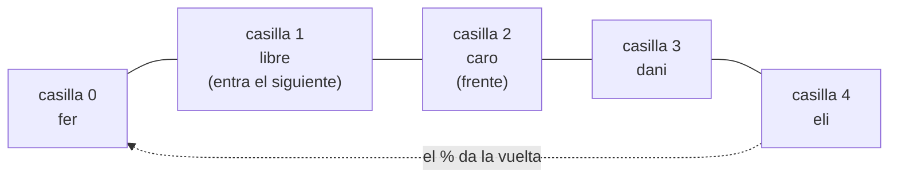

# Informe del avance

## 1. El escenario

El programa simula la sala de espera de una clínica. Los pacientes van llegando y cada uno trae un nivel de urgencia entre 1 y 5, donde 5 es lo más grave. Mientras esperan quedan en la sala, y cuando hay un médico libre se llama al siguiente.

Lo usaría, por ejemplo, la recepción de la clínica: para registrar a cada paciente que llega, saber a quién le toca pasar, cuántas personas siguen esperando y cuánto se han demorado en promedio los que ya fueron atendidos.

De cada paciente se guarda su nombre, su urgencia y el número de la orden en que llegó. No usamos un reloj de verdad: cada orden que se lee cuenta como una unidad de tiempo. Así, lo que esperó un paciente es

$$\text{espera} = \text{orden en que lo atienden} - \text{orden en que llegó}$$

La primera línea de la entrada dice cuántas órdenes vienen, y después llegan las órdenes, una por línea:

- `LLEGA nombre urgencia`: registra a un paciente. No escribe nada.
- `ATIENDE`: llama al siguiente y escribe su nombre, o `nadie espera` si la sala está vacía.
- `ESPERAN`: escribe cuántos pacientes hay en la sala.
- `PROMEDIO`: escribe con un decimal cuánto esperaron en promedio los que ya fueron atendidos.

Un ejemplo con dos pacientes y seis órdenes:

| Orden | Qué pasa | Lo que escribe |
|---|---|---|
| 1. `LLEGA camila 1` | Llega camila, con urgencia 1 | — |
| 2. `LLEGA andres 4` | Llega andres, con urgencia 4 | — |
| 3. `ATIENDE` | Pasa camila, que esperó $3 - 1 = 2$ | `camila` |
| 4. `ESPERAN` | Solo queda andres en la sala | `1` |
| 5. `ATIENDE` | Pasa andres, que esperó $5 - 2 = 3$ | `andres` |
| 6. `PROMEDIO` | $(2 + 3) / 2 = 2.5$ | `2.5` |

En el avance la clínica atiende por orden de llegada, sin mirar la urgencia. Por eso en el ejemplo andres, que estaba más grave, esperó más que camila solo porque llegó después. En la entrega final eso cambia: con el montículo se atenderá primero al más urgente, y vamos a comparar cuánto esperan los urgentes en cada caso.

## 2. Qué guarda la estructura y qué operaciones necesita

La estructura es una cola circular sobre un arreglo. Guarda a los pacientes que están en la sala, en el orden en que llegaron. Cada paciente es un `struct Paciente` con:

- `nombre`: hasta 50 letras, más el `'\0'` del final.
- `urgencia`: de 1 a 5. En el avance la cola no la usa, pero la guardamos porque el montículo de la entrega final la necesita, y así las dos estructuras reciben el mismo paciente.
- `llegada`: el número de la orden en que llegó, para calcular cuánto esperó.

La cola (`struct Cola`) tiene:

- `datos`: el arreglo de pacientes, reservado con un solo `malloc` al crear la cola. Los pacientes se copian dentro del arreglo, así que no hace falta un `malloc` por cada uno.
- `capacidad`: cuántos pacientes caben. Usamos $N$, el número de órdenes de la primera línea, porque como mucho puede haber $N$ órdenes `LLEGA`.
- `frente`: la casilla del próximo paciente que se va a atender.
- `cantidad`: cuántos pacientes están esperando.

Las operaciones que necesita el programa, y la orden que usa cada una:

| Operación | Qué hace | Precondición |
|---|---|---|
| `crearCola(capacidad)` | Reserva la cola y su arreglo y la deja vacía, con $\text{frente} = 0$ y $\text{cantidad} = 0$. Si `malloc` falla devuelve `NULL` y el programa no sigue. | Ninguna. Si la capacidad es menor que 1, se usa 1. |
| `registrar(c, p)`, orden `LLEGA` | Pone al paciente al final de la cola. Devuelve 1 si entró y 0 si no cabía. | Que quepa alguien: $\text{cantidad} \lt \text{capacidad}$. Si la cola está llena, el paciente no entra (decisión del grupo). |
| `atender(c, &p)`, orden `ATIENDE` | Saca al paciente del frente y lo deja en `p`. Devuelve 1 si había alguien y 0 si no. | Que haya alguien: $\text{cantidad} \gt 0$. Si no hay nadie, el programa escribe `nadie espera`. |
| `cantidad(c)`, orden `ESPERAN` | Devuelve cuántos pacientes están esperando. | Que la cola exista. |
| `estaVacia(c)` | Devuelve 1 si no hay nadie esperando. La usa `atender`. | Que la cola exista. |
| `estaLlena(c)` | Devuelve 1 si ya no cabe nadie. La usa `registrar`. | Que la cola exista. |
| `destruirCola(c)` | Libera el arreglo y después la cola. | Que la cola no se vuelva a usar. Si `c` es `NULL`, no hace nada. |

`PROMEDIO` no es una operación de la cola. Los pacientes atendidos ya salieron de ella, así que la cola no podría calcularlo. Lo hace el `main` con dos contadores, `pacientesAtendidos` y `sumaEsperas`: cada vez que `ATIENDE` saca a alguien, suma lo que esperó y cuenta uno más. Así `PROMEDIO` solo hace una división, sin recorrer la sala:

$$\text{promedio} = \frac{\text{sumaEsperas}}{\text{pacientesAtendidos}}$$

Si todavía no se ha atendido a nadie, escribe `0.0` (decisión del grupo), para no dividir entre cero.

## 3. La estructura escogida y por qué

En el avance la clínica atiende por orden de llegada: el primero que llega es el primero que pasa, sin importar su urgencia. Esto es una cola FIFO, primero en entrar, primero en salir (Thareja, capítulo 8). Lo que más se repite es registrar pacientes y atenderlos, así que esas dos operaciones tienen que ser rápidas.

Comparamos cuatro estructuras lineales:

| Estructura | Qué pasa al atender | Costo de atender |
|---|---|---|
| Pila | Sale el último que llegó. No sirve para una sala de espera, porque el que acaba de llegar pasaría antes que los que llevan rato esperando. | — |
| Arreglo normal, sacando de la posición 0 | Sale el primero, pero toca correr a todos los demás una posición para tapar el hueco. Con $n$ pacientes son $n-1$ movimientos. | $O(n)$ |
| Lista enlazada | Sale el primero sin mover a nadie, pero cada paciente necesita su propio `malloc` y un puntero extra al siguiente. | $O(1)$ |
| Cola circular sobre arreglo | Sale el que está en `frente` y `frente` avanza una casilla. Con `%`, cuando llega al final vuelve a la casilla 0. Nadie se mueve. | $O(1)$ |

Descartamos la pila porque no respeta el orden de llegada, y el arreglo normal porque atender cuesta $O(n)$. Entre la lista enlazada y la cola circular, que cuestan lo mismo, escogimos la cola circular: como nunca puede haber más de $N$ pacientes esperando ($N$ es el número de órdenes), basta con reservar el arreglo una sola vez al inicio, sin un `malloc` por cada paciente ni punteros extra. Esto se explica en Thareja, capítulo 8, sección 8.4.1 (colas circulares), y en las notas de la Clase 11, en la parte "Por qué la cola no es una lista que elimina en la posición 0".

Costos esperados, con $n$ los pacientes que están esperando y $N$ la capacidad de la cola. Tomamos el costo de `malloc` y `free` como constante.

| Operación | Tiempo | Espacio extra | Por qué |
|---|---|---|---|
| `crearCola` | $O(1)$ | $O(N)$ | Hace dos `malloc` (la cola y el arreglo) y llena 3 campos, sin recorrer el arreglo. La memoria sí depende de $N$, porque reserva las $N$ casillas de una vez. |
| `registrar` | $O(1)$ | $O(1)$ | Sin ciclos: calcula la posición con $(\text{frente} + \text{cantidad}) \bmod N$, guarda al paciente y suma 1. Hace lo mismo con 10 pacientes o con un millón. |
| `atender` | $O(1)$ | $O(1)$ | Sin ciclos: copia al paciente del frente, avanza `frente` con $\bmod N$ y resta 1. Nadie se mueve en el arreglo. |
| `cantidad` | $O(1)$ | $O(1)$ | Solo devuelve el campo `cantidad`. |
| `estaVacia` | $O(1)$ | $O(1)$ | Solo compara `cantidad` con 0. |
| `estaLlena` | $O(1)$ | $O(1)$ | Solo compara `cantidad` con la capacidad. |
| `destruirCola` | $O(1)$ | $O(1)$ | Hace dos `free`, primero el arreglo y luego la cola, sin recorrer a los pacientes. |

En total la cola ocupa $O(N)$ de memoria y todas sus operaciones cuestan $O(1)$.

El invariante de la cola, que se cumple antes y después de cada operación:

$$I:\quad 0 \leq \text{cantidad} \leq \text{capacidad} \quad \land \quad 0 \leq \text{frente} < \text{capacidad}$$

`cantidad` nunca es negativa porque `atender` solo resta si hay alguien, y nunca pasa de la capacidad porque `registrar` solo suma si hay espacio; si pasara, se escribiría por fuera del arreglo. `frente` nunca llega a la capacidad porque siempre avanza con $\bmod$ capacidad, que da un valor entre $0$ y $\text{capacidad} - 1$.

Así se ve la cola en un momento dado. Con capacidad 5: llegaron ana, beto y caro; se atendió a ana y a beto, y el frente pasó a la casilla 2; después llegaron dani (casilla 3), eli (casilla 4) y fer, que entró en $(2 + 3) \bmod 5 = 0$, la casilla que dejó libre ana. Quedan $\text{frente} = 2$ y $\text{cantidad} = 4$, y el siguiente entraría en $(2 + 4) \bmod 5 = 1$.

## 4. Qué piensan medir

En la entrega final vamos a comparar la cola circular con un montículo binario, que atiende primero al más urgente, y con `priority_queue` de la biblioteca estándar como referencia.

Vamos a medir dos cosas:

- **Cuánto esperan los pacientes según su urgencia.** Calculamos la espera promedio de los pacientes más urgentes (urgencia 5) y de los menos urgentes (urgencia 1) en cada estructura. Esperamos que con el montículo los urgentes esperen mucho menos que con la cola, y que los de urgencia baja esperen más, porque los urgentes les pasan adelante aunque hayan llegado después.
- **Cuánto se demora cada estructura.** Medimos el tiempo total de procesar todas las órdenes. Esperamos que la cola sea más rápida, porque registrar y atender cuestan $O(1)$. En el montículo cuestan $O(\log n)$, porque al registrar el paciente tiene que flotar y al atender hay que hundir al que queda arriba, y eso recorre la altura del árbol.

Para las pruebas vamos a generar entradas de 1.000, 5.000, 10.000, 50.000 y 100.000 órdenes, mezclando llegadas y atenciones con urgencias al azar entre 1 y 5. Las tres estructuras reciben exactamente los mismos pacientes en el mismo orden, para que lo único que cambie sea la estructura. Si con 100.000 órdenes los tiempos salen muy pequeños, agregamos tamaños más grandes. Todo se mide en el mismo computador y con el mismo compilador, repitiendo cada tamaño varias veces y sacando el promedio.

En resumen, esperamos que la cola sea más rápida, pero que el montículo atienda mejor a quien más lo necesita.

## 5. Casos de prueba

| Caso | Entrada | Salida esperada | Salida obtenida |
|---|---|---|---|
| funcional 1 |  |  |  |
| funcional 2 |  |  |  |
| funcional 3 |  |  |  |
| límite |  |  |  |

(El caso límite es la estructura vacía, con un solo elemento, llena, o
con la clave repetida: digan cuál escogieron y por qué.)
