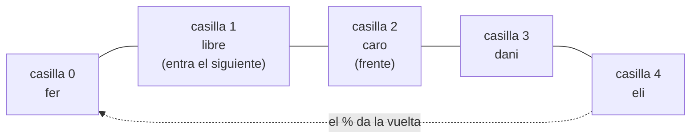

# Informe del avance

*(Borren los comentarios entre paréntesis al escribir.)*

## 1. El escenario

(Descríbanlo en sus propias palabras: qué guarda el programa, quién lo
usa y para qué. No copien el enunciado.)

## 2. Qué guarda la estructura y qué operaciones necesita

| Operación | Qué hace | Precondición |
|---|---|---|
|  |  |  |

## 3. La estructura escogida y por qué

En el avance, la clínica atiende a los pacientes en el orden en que llegan: el primero que llega es el primero que pasa, sin importar su urgencia. Esa disciplina se llama FIFO, primero en entrar, primero en salir (Thareja, capítulo 8). Las dos operaciones que más se repiten son registrar a un paciente que llega y atender al siguiente, así que las dos tienen que ser baratas.

Se compararon cuatro estructuras lineales:

| Estructura | Qué pasa al atender | Costo de atender |
|---|---|---|
| Pila | Sale el último que llegó, no el primero. En una sala de espera eso no sirve: el que acaba de llegar pasaría antes que los que llevan rato esperando. | — |
| Arreglo normal, sacando de la posición 0 | Sale el primero, pero hay que correr a todos los demás una posición hacia adelante para llenar el hueco. Con $n$ pacientes son $n-1$ movimientos. | $O(n)$ |
| Lista enlazada | Sale el primero sin mover a nadie, pero cada paciente necesita su propio `malloc` y un puntero extra hacia el siguiente. | $O(1)$ |
| Cola circular sobre arreglo | Sale el que está en `frente`, y `frente` avanza una casilla con `%`: al pasarse del final vuelve a la casilla 0. Nadie se mueve dentro del arreglo. | $O(1)$ |

La pila se descarta porque no respeta el orden de llegada, y el arreglo normal porque atender cuesta $O(n)$. Entre las dos que quedan en $O(1)$, se escogió la cola circular: como nunca puede haber más de $N$ pacientes esperando ($N$ es el número de órdenes de la entrada), basta con un solo `malloc` de $N$ casillas al inicio, sin un puntero extra por paciente ni una reserva de memoria en cada llegada. Así se explica en Thareja, capítulo 8, sección 8.4.1 (colas circulares), y en las notas de la Clase 11, en la parte "Por qué la cola no es una lista que elimina en la posición 0".

Costos esperados, con $n$ el número de pacientes que esperan y $N$ la capacidad de la cola (el número de órdenes de la entrada). El costo de `malloc` y `free` se toma como constante.

| Operación | Tiempo | Espacio extra | Por qué |
|---|---|---|---|
| `crearCola` | $O(1)$ | $O(N)$ | Hace dos `malloc`, uno para la cola y otro para el arreglo de $N$ pacientes, y solo pone 3 campos: no recorre el arreglo. La memoria sí crece con $N$, porque se reservan las $N$ casillas de una vez. |
| `registrar` | $O(1)$ | $O(1)$ | No tiene ciclos: calcula la posición con $(\text{frente} + \text{cantidad}) \bmod N$, copia al paciente y suma 1. Son las mismas operaciones con 10 pacientes o con un millón, y usa el arreglo que ya existe. |
| `atender` | $O(1)$ | $O(1)$ | No tiene ciclos: copia al paciente del frente, avanza `frente` con $\bmod N$ y resta 1. Nadie se mueve dentro del arreglo. |
| `cantidad` | $O(1)$ | $O(1)$ | Solo devuelve el campo `cantidad`. |
| `estaVacia` | $O(1)$ | $O(1)$ | Solo compara `cantidad` con 0. |
| `estaLlena` | $O(1)$ | $O(1)$ | Solo compara `cantidad` con la capacidad. |
| `destruirCola` | $O(1)$ | $O(1)$ | Hace dos `free`, primero el arreglo y luego la cola, sin recorrer a los pacientes. |

En total, la cola ocupa $O(N)$ memoria y cada operación cuesta $O(1)$ en tiempo, sin importar cuántos pacientes haya.

El invariante de la cola, que se cumple antes y después de cada operación:

$$I:\quad 0 \leq \text{cantidad} \leq \text{capacidad} \quad \land \quad 0 \leq \text{frente} < \text{capacidad}$$

`cantidad` nunca es negativa porque `atender` solo resta cuando la cola no está vacía, y nunca pasa de la capacidad porque `registrar` solo suma cuando la cola no está llena; si pasara, se escribiría fuera del arreglo. `frente` nunca llega a la capacidad porque siempre se avanza con $\bmod$ capacidad, que devuelve un valor entre $0$ y $\text{capacidad} - 1$.

Un diagrama del estado de la cola, en Mermaid. Con capacidad 5: llegaron ana, beto y caro; se atendió a ana y a beto, y el frente pasó a la casilla 2; luego llegaron dani (casilla 3), eli (casilla 4) y fer, que entró en $(2 + 3) \bmod 5 = 0$, la casilla que dejó libre ana. Queda $\text{frente} = 2$ y $\text{cantidad} = 4$, y el siguiente entraría en $(2 + 4) \bmod 5 = 1$.

## 4. Qué piensan medir

(Qué entrada van a variar, entre qué tamaños, y qué esperan ver.)

## 5. Casos de prueba

| Caso | Entrada | Salida esperada | Salida obtenida |
|---|---|---|---|
| funcional 1 |  |  |  |
| funcional 2 |  |  |  |
| funcional 3 |  |  |  |
| límite |  |  |  |

(El caso límite es la estructura vacía, con un solo elemento, llena, o
con la clave repetida: digan cuál escogieron y por qué.)
