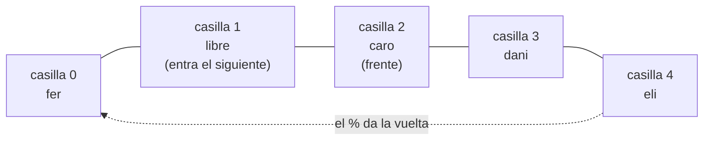
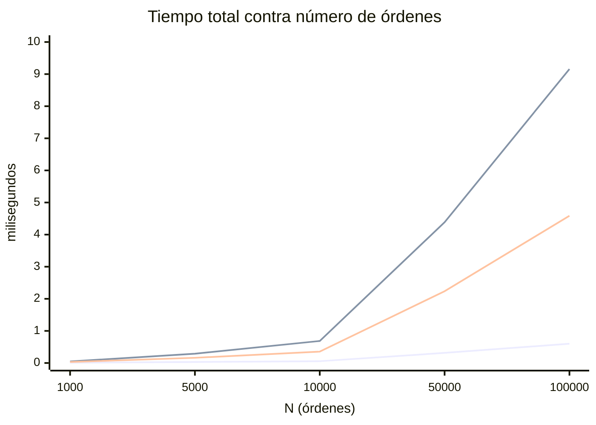

# Informe final

## 1. El escenario y el modelado

El programa simula la sala de espera de una clínica. Los pacientes van llegando y cada uno trae un nivel de urgencia entre 1 y 5, donde 5 es lo más grave. Mientras esperan quedan en la sala, y cuando hay un médico libre se llama al siguiente. Lo usaría la recepción de la clínica: para registrar a cada paciente que llega, saber a quién le toca pasar, cuántas personas siguen esperando y cuánto se han demorado en promedio los que ya fueron atendidos.

De cada paciente se guarda su nombre (máximo 50 letras), su urgencia y el número de la orden en que llegó. No usamos un reloj de verdad: cada orden que se lee cuenta como una unidad de tiempo. Así, lo que esperó un paciente es

$$\text{espera} = \text{orden en que lo atienden} - \text{orden en que llegó}$$

La primera línea de la entrada dice cuántas órdenes vienen, y después llegan las órdenes, una por línea:

- `LLEGA nombre urgencia`: registra a un paciente. No escribe nada.
- `ATIENDE`: llama al siguiente y escribe su nombre, o `nadie espera` si la sala está vacía.
- `ESPERAN`: escribe cuántos pacientes hay en la sala.
- `PROMEDIO`: escribe con un decimal cuánto esperaron en promedio los que ya fueron atendidos, o `0.0` si todavía no se ha atendido a nadie.

**Dos formas de atender.** En el avance, la sala atendía por orden de llegada, con una cola circular. En la entrega final agregamos un montículo, que atiende primero al más urgente; si dos pacientes tienen la misma urgencia, pasa el que llegó antes. El mismo programa funciona con cualquiera de las dos, y solo cambia con cuál se compila. Un ejemplo con dos pacientes y seis órdenes:

| Orden | Con la cola (por llegada) | Con el montículo (por urgencia) |
|---|---|---|
| 1. `LLEGA camila 1` | llega camila, con urgencia 1 | igual |
| 2. `LLEGA andres 4` | llega andres, con urgencia 4 | igual |
| 3. `ATIENDE` | `camila`: llegó primero, esperó $3 - 1 = 2$ | `andres`: es el más urgente, esperó $3 - 2 = 1$ |
| 4. `ESPERAN` | `1` | `1` |
| 5. `ATIENDE` | `andres`, que esperó $5 - 2 = 3$ | `camila`, que esperó $5 - 1 = 4$ |
| 6. `PROMEDIO` | $(2 + 3)/2 =$ `2.5` | $(1 + 4)/2 =$ `2.5` |

El promedio sale igual porque se atiende a los mismos pacientes en las mismas órdenes; lo que cambia es quién espera. Con la cola, andres, que estaba más grave, esperó 3 solo porque llegó después; con el montículo esperó 1, y la que esperó más fue camila, la menos urgente. Eso es lo que medimos en la sección 4: cuánto esperan los urgentes con cada estructura y cuánto cuesta cada una.

**Correcciones respecto al avance.** Atendiendo la realimentación: un nombre de más de 50 letras ahora se guarda con sus primeras 50 y se descarta el resto, para que no se lea como urgencia ni como órdenes y no se desfase el reloj (caso `caso7-limite-nombre-largo`). Y como la sala se crea con capacidad igual al número de órdenes, en el programa principal el índice de la cola nunca da la vuelta; por eso agregamos `codigo/prueba_cola.cpp`, que usa una sala de 3 casillas para que el módulo sí se ejerza (sección 2).

## 2. Las dos estructuras

### La interfaz común

Las dos estructuras implementan la misma interfaz, `codigo/sala.h`: el mismo `struct Paciente`, el mismo `struct Sala` y las mismas siete funciones con las mismas firmas. Así `principal.cpp` y `medir.cpp` funcionan con cualquiera de las dos sin cambiar una línea; solo cambia con qué archivo se compilan, como en la Clase 10 con `racional.h` y sus dos implementaciones. El `Makefile` arma `proyecto_cola` y `medir_cola` con `cola.cpp`, y `proyecto_monticulo` y `medir_monticulo` con `monticulo.cpp`.

| Operación | Qué hace | Precondición | Cola circular (`cola.cpp`) | Montículo (`monticulo.cpp`) |
|---|---|---|---|---|
| `crearSala(capacidad)` | Reserva la sala vacía; devuelve `NULL` si no hay memoria | Ninguna; si la capacidad es menor que 1 se usa 1 | Igual en las dos | Igual en las dos |
| `destruirSala(c)` | Libera el arreglo y la sala | Ninguna; con `NULL` no hace nada | Igual en las dos | Igual en las dos |
| `registrar(c, p)` | Mete a `p`; devuelve 1 si entró, 0 si la sala estaba llena | Que la sala exista | Lo pone al final de la fila, en $(\text{frente} + \text{cantidad}) \bmod \text{capacidad}$ | Lo pone en la primera casilla libre y lo sube |
| `atender(c, p)` | Saca al siguiente y lo copia en `*p`; devuelve 1 si había alguien, 0 si estaba vacía | Que la sala exista | Saca al de `frente` y lo avanza con el módulo | Saca la raíz, pasa el último a la raíz y lo baja |
| `cantidad(c)`, `estaVacia(c)`, `estaLlena(c)` | Consultan el campo `cantidad` | Que la sala exista | Igual en las dos | Igual en las dos |

Los dos usan los mismos cuatro campos de `Sala` (`datos`, `capacidad`, `frente` y `cantidad`). En la cola, `frente` es la casilla del próximo a atender y se mueve con el módulo; en el montículo vale siempre 0, porque el próximo a atender siempre está en la raíz. El montículo reutiliza la `urgencia` y la `llegada` que ya traía `Paciente`.

**Decisiones del grupo** (el enunciado no las fija):

- La sala se crea con capacidad $N$, el número de órdenes de la entrada: como cada orden trae a lo sumo una llegada, nunca hay más de $N$ esperando.
- Si la sala está llena, `registrar` devuelve 0 y el paciente no entra.
- `PROMEDIO` sin atendidos escribe `0.0`.
- Los nombres tienen máximo 50 letras; si llega uno más largo, se guardan las primeras 50 y se descarta el resto.
- **Desempate en el montículo:** si dos pacientes tienen la misma urgencia, pasa el que llegó antes (menor `llegada`). Un montículo no respeta el orden de llegada por sí solo, y sin esta regla dos pacientes igual de graves saldrían en cualquier orden.

### La cola circular por dentro

Con capacidad 5: llegaron ana, beto y caro; se atendió a ana y a beto, y el frente pasó a la casilla 2; después llegaron dani (casilla 3), eli (casilla 4) y fer, que entró en $(2 + 3) \bmod 5 = 0$, la casilla que dejó libre ana. Quedan $\text{frente} = 2$ y $\text{cantidad} = 4$, y el siguiente entraría en $(2 + 4) \bmod 5 = 1$.

Como señaló la realimentación del avance, esto **no ocurre en el programa principal**: la sala se crea con capacidad $N$, y como a lo sumo llegan $N$ pacientes, la casilla $(\text{frente} + \text{cantidad})$ nunca alcanza la capacidad y el módulo nunca da la vuelta. Por eso agregamos `codigo/prueba_cola.cpp`, que crea una sala de **3 casillas** y hace exactamente esto: la llena, intenta meter un cuarto, atiende a uno, registra otro que entra en la casilla 0, y atiende hasta vaciarla. `make pruebas` la corre.

El montículo por dentro, con su árbol y su arreglo, está dibujado en la sección 3, junto a su invariante.

### Casos de prueba y la rama del código que ejercita cada uno

Los casos de la cola están en `datos/` y los del montículo en `datos/monticulo/`, como pares `nombre.in` y `nombre.out`. `make pruebas` los corre todos, más `prueba_cola`. Todos dan la salida esperada.

| Caso | Tipo | Estructura | Rama del código que ejercita |
|---|---|---|---|
| `caso1-ejemplo-enunciado` | Funcional | Las dos | El ejemplo del enunciado: con la cola sale ana primero; con el montículo, beto, por la comparación de urgencias de `vaAntes` (`monticulo.cpp:15`) |
| `caso2-orden-de-llegada` | Funcional | Las dos | Con la cola, el orden de llegada aunque los urgentes lleguen después; con el montículo, `subir` y `bajar` reordenan |
| `caso3-llegadas-y-atenciones-mezcladas` | Funcional | Las dos | Llegadas y atenciones intercaladas: la sala se vacía y se vuelve a llenar |
| `caso4-limite-sala-vacia` | Límite | Las dos | `ATIENDE` con la sala vacía: `!estaVacia(c)` es falso (`cola.cpp:85`, `monticulo.cpp:173`), `atender` devuelve 0 y `principal.cpp:59` escribe `nadie espera`. `PROMEDIO` sin atendidos: `pacientesAtendidos > 0` es falso (`principal.cpp:73`) y escribe `0.0` |
| `caso5-limite-un-solo-paciente` | Límite | Las dos | Con un solo paciente: en el montículo, `subir` no entra al ciclo porque `i > 0` es falso (`monticulo.cpp:40`), y `bajar` no encuentra hijos porque `izquierdo < cantidad` es falso (`monticulo.cpp:69`). El segundo `ATIENDE` vuelve a la rama de sala vacía |
| `caso6-empate-de-urgencias` | Límite | Montículo | Pacientes con la misma urgencia: la rama del desempate, `a->llegada < b->llegada` (`monticulo.cpp:19`), hace pasar primero al que llegó antes |
| `caso7-limite-nombre-largo` | Límite | Las dos | Un nombre de 60 letras: el ciclo que descarta lo que sobra (`principal.cpp:36`) evita que se lea como urgencia; se guarda con 50 letras y el reloj no se desfasa |
| `prueba_cola` | Límite | Cola | Con 3 casillas: la rama de sala llena, `!estaLlena(c)` falso (`cola.cpp:67`), donde `registrar` devuelve 0; el módulo de `registrar` da la vuelta (`cola.cpp:70`, eli entra en la casilla 0), y el de `atender` también (`cola.cpp:90`, el frente pasa de 2 a 0) |

No hay caso de **clave repetida**: la sala no busca pacientes por nombre, así que dos pacientes con el mismo nombre se atienden como dos pacientes distintos.

## 3. Análisis formal de complejidad

### Cola circular: el invariante

Para abreviar, sea $\text{pos}(i) = (\text{frente} + i) \bmod \text{capacidad}$ la casilla del arreglo donde está el paciente que ocupa el lugar $i$ de la fila, contando desde 0. El invariante de la cola es:

$$
I_{\text{cola}}: \quad
0 \leq \text{cantidad} \leq \text{capacidad}
\;\land\;
0 \leq \text{frente} < \text{capacidad}
\;\land\;
\forall i \,\big(0 \leq i < \text{cantidad} - 1 \;\rightarrow\; \text{datos}[\text{pos}(i)].\text{llegada} < \text{datos}[\text{pos}(i+1)].\text{llegada}\big)
$$

Es decir: la cantidad y el frente están dentro de sus rangos, y los pacientes que esperan ocupan las casillas $\text{pos}(0), \ldots, \text{pos}(\text{cantidad} - 1)$ en orden de llegada: cada uno llegó antes que el que tiene detrás.

**Quién lo establece y quién lo preserva:**

- `crearSala` lo **establece**: deja $\text{cantidad} = 0$ y $\text{frente} = 0$, y con la sala vacía no hay ningún $i$ en el rango, así que la tercera parte se cumple sin nada que revisar.
- `registrar` lo **preserva**: pone al paciente nuevo en $\text{pos}(\text{cantidad})$, justo detrás del último, y como su `llegada` es el número de la orden actual, es mayor que la de todos los que ya esperan. Solo suma si la sala no está llena, así que `cantidad` no pasa de la capacidad.
- `atender` lo **preserva**: saca al de $\text{pos}(0)$ y avanza `frente` con el módulo, así que el que era el lugar 1 pasa a ser el lugar 0 y los demás siguen en el mismo orden. Solo resta si hay alguien, así que `cantidad` no queda negativa.
- `cantidad`, `estaVacia` y `estaLlena` no cambian nada, así que lo preservan.

La cola circular sobre arreglo es la de Thareja, capítulo 8, sección 8.4.1.

### Cola circular: `registrar`

**Teorema.** Sea $n$ el número de pacientes que esperan en la sala. El tiempo de `registrar` en la cola circular cumple $T(n) \in O(1)$, y su espacio extra cumple $S(n) \in O(1)$.

**Demostración.** Se procede de forma directa: se cuentan las operaciones elementales en el peor caso, que es cuando la sala no está llena y el paciente sí entra, porque es cuando se ejecutan todas las líneas.

*Desarrollo.* `registrar` no tiene ciclos ni llamadas recursivas: cada línea se ejecuta a lo sumo una vez. Se cuentan las asignaciones, comparaciones, operaciones aritméticas y retornos:

| Línea | Operaciones |
|---|---|
| `int ok = 0` | 1 |
| `estaLlena(c)`: comparar `cantidad` con `capacidad` y retornar | 2 |
| `if (!estaLlena(c))` | 1 |
| `pos = (frente + cantidad) % capacidad` | 3 |
| `datos[pos] = p` | 1 |
| `cantidad += 1` | 1 |
| `ok = 1` | 1 |
| `return ok` | 1 |

Ninguna de estas cantidades depende de $n$: el arreglo no se recorre, porque la posición donde entra el paciente se calcula directamente con el módulo. Entonces

$$T(n) = 11 \leq 11 \cdot 1 \quad \text{para todo } n \geq 1.$$

En espacio, `registrar` solo usa dos variables enteras (`ok` y `pos`) y la copia del paciente que recibe como parámetro; el arreglo `datos` ya fue reservado por `crearSala`. Entonces $S(n) = 2 + 1 = 3 \leq 3 \cdot 1$ para todo $n \geq 1$.

*Conclusión.* Por lo tanto, $T(n) \in O(1)$ con testigos $c = 11$ y $k = 1$, y $S(n) \in O(1)$ con testigos $c = 3$ y $k = 1$.

### Cola circular: `atender`

**Teorema.** Sea $n$ el número de pacientes que esperan en la sala. El tiempo de `atender` en la cola circular cumple $T(n) \in O(1)$, y su espacio extra cumple $S(n) \in O(1)$.

**Demostración.** Se procede de forma directa: se cuentan las operaciones elementales en el peor caso, que es cuando la sala no está vacía y sí se atiende a alguien, porque es cuando se ejecutan todas las líneas.

*Desarrollo.* `atender` no tiene ciclos ni llamadas recursivas: cada línea se ejecuta a lo sumo una vez.

| Línea | Operaciones |
|---|---|
| `int ok = 0` | 1 |
| `estaVacia(c)`: comparar `cantidad` con 0 y retornar | 2 |
| `if (!estaVacia(c))` | 1 |
| `*p = datos[frente]` | 1 |
| `frente = (frente + 1) % capacidad` | 3 |
| `cantidad -= 1` | 1 |
| `ok = 1` | 1 |
| `return ok` | 1 |

Ninguna de estas cantidades depende de $n$. En un arreglo normal, sacar al primero obliga a correr a los $n - 1$ restantes una casilla; aquí el primero no tiene que estar en la casilla 0, sino en la que indica `frente`, así que basta con avanzar `frente` una casilla con el módulo, y ningún paciente se mueve dentro del arreglo. Entonces

$$T(n) = 11 \leq 11 \cdot 1 \quad \text{para todo } n \geq 1.$$

En espacio, `atender` solo usa la variable entera `ok` y el puntero `p` que recibe como parámetro; el paciente que sale se copia en una variable de quien llama. Entonces $S(n) = 2 \leq 2 \cdot 1$ para todo $n \geq 1$.

*Conclusión.* Por lo tanto, $T(n) \in O(1)$ con testigos $c = 11$ y $k = 1$, y $S(n) \in O(1)$ con testigos $c = 2$ y $k = 1$.

### Cola circular: `crearSala`

**Teorema.** Sea $N$ la capacidad de la sala. El tiempo de `crearSala` cumple $T(N) \in O(1)$, y su espacio cumple $S(N) \in O(N)$.

**Demostración.** Se procede de forma directa: se cuentan las operaciones en el peor caso, que es cuando la capacidad llega menor que 1 y los dos `malloc` salen bien, porque es cuando se ejecutan todas las líneas. Para el espacio se cuentan las casillas que se reservan. El costo de `malloc` se toma como constante.

*Desarrollo.* `crearSala` no tiene ciclos: cada línea se ejecuta a lo sumo una vez.

| Línea | Operaciones |
|---|---|
| `if (capacidad < 1)` y `capacidad = 1` | 2 |
| `c = malloc(sizeof(Sala))` | 2 |
| `if (c != NULL)` | 1 |
| `c->datos = malloc(sizeof(Paciente) * capacidad)` | 3 |
| `if (c->datos == NULL)` | 1 |
| `capacidad`, `frente` y `cantidad` del `else` | 3 |
| `return c` | 1 |

Ninguna depende de $N$: el arreglo se reserva de una vez y no se recorre para llenarlo. Entonces

$$T(N) = 13 \leq 13 \cdot 1 \quad \text{para todo } N \geq 1.$$

En espacio, se reserva una estructura `Sala` de tamaño fijo (cuatro campos) y un arreglo de $N$ casillas, una por cada paciente que puede llegar. Contando en casillas, $S(N) = N + 1$. Como $1 \leq N$ para todo $N \geq 1$ (la función garantiza que la capacidad es al menos 1),

$$S(N) = N + 1 \leq N + N = 2N \quad \text{para todo } N \geq 1.$$

*Conclusión.* Por lo tanto, $T(N) \in O(1)$ con testigos $c = 13$ y $k = 1$, y $S(N) \in O(N)$ con testigos $c = 2$ y $k = 1$.

### Cola circular: `destruirSala`

**Teorema.** Sea $N$ la capacidad de la sala. El tiempo de `destruirSala` cumple $T(N) \in O(1)$, y su espacio extra cumple $S(N) \in O(1)$.

**Demostración.** Se procede de forma directa: se cuentan las operaciones en el peor caso, que es cuando la sala existe y se liberan sus dos bloques. El costo de `free` se toma como constante.

*Desarrollo.* La función compara `c` con `NULL` (1 operación) y hace dos llamadas a `free` (2 operaciones): una libera el arreglo `datos` completo como un solo bloque, sin recorrer sus $N$ casillas, y la otra libera la estructura `Sala`. No tiene ciclos y no reserva memoria. Entonces $T(N) = 3 \leq 3 \cdot 1$ y $S(N) = 0 \leq 1 \cdot 1$ para todo $N \geq 1$.

*Conclusión.* Por lo tanto, $T(N) \in O(1)$ con testigos $c = 3$ y $k = 1$, y $S(N) \in O(1)$ con testigos $c = 1$ y $k = 1$.

### Cola circular: `cantidad`, `estaVacia` y `estaLlena`

**Teorema.** Sea $n$ el número de pacientes que esperan. El tiempo de cada una de las tres consultas `cantidad`, `estaVacia` y `estaLlena` cumple $T(n) \in O(1)$, y su espacio extra cumple $S(n) \in O(1)$.

**Demostración.** Se procede de forma directa: cada consulta es una sola línea, y se cuentan sus operaciones.

*Desarrollo.*

| Operación | Lo que hace | Operaciones |
|---|---|---|
| `cantidad` | retorna el campo `cantidad` | 1 |
| `estaVacia` | compara `cantidad` con 0 y retorna | 2 |
| `estaLlena` | compara `cantidad` con `capacidad` y retorna | 2 |

Ninguna recorre el arreglo, porque el número de pacientes ya está guardado en el campo `cantidad`, que `registrar` y `atender` mantienen al día. Ninguna reserva memoria. Entonces, para las tres, $T(n) \leq 2 \leq 2 \cdot 1$ y $S(n) = 0 \leq 1 \cdot 1$ para todo $n \geq 1$.

*Conclusión.* Por lo tanto, las tres cumplen $T(n) \in O(1)$ con testigos $c = 2$ y $k = 1$, y $S(n) \in O(1)$ con testigos $c = 1$ y $k = 1$.

### Montículo: el invariante

Un montículo binario de máximos guardado en `datos`, con índices desde 0. Sea $\text{padre}(i) = \lfloor (i-1)/2 \rfloor$ para $i \geq 1$; los hijos de $i$ son $2i+1$ y $2i+2$. Sea $a \preceq b$ ("$a$ va antes o igual que $b$") la relación

$$
a \preceq b \;\iff\; a.\text{urgencia} > b.\text{urgencia} \;\lor\; \big(a.\text{urgencia} = b.\text{urgencia} \;\land\; a.\text{llegada} \leq b.\text{llegada}\big).
$$

Como cada `LLEGA` tiene su propio número de orden, dos pacientes distintos nunca tienen la misma `llegada`, así que $\preceq$ es un orden total y transitivo sobre los pacientes de la sala: de dos pacientes distintos, siempre uno va antes que el otro. El invariante del montículo es:

$$
I_{\text{mont}}: \quad
0 \leq \text{cantidad} \leq \text{capacidad}
\;\land\;
\text{frente} = 0
\;\land\;
\forall i \,\big(1 \leq i < \text{cantidad} \;\rightarrow\; \text{datos}[\text{padre}(i)] \preceq \text{datos}[i]\big)
$$

Es decir: la cantidad está en su rango, `frente` vale siempre 0, y todo paciente de la casilla $i$ (con $1 \leq i < \text{cantidad}$) va después o igual que su padre. Por transitividad, el que va primero de todos está en la casilla 0, que es donde `atender` lo busca.

```mermaid
flowchart LR
  subgraph arbol["Árbol (cada nodo: casilla, paciente, urgencia, llegada)"]
    direction TB
    n0["casilla 0<br/>beto · urg 5 · lleg 2"] --> n1["casilla 1<br/>ana · urg 2 · lleg 1"]
    n0 --> n2["casilla 2<br/>caro · urg 3 · lleg 4"]
    n1 --> n3["casilla 3<br/>dani · urg 1 · lleg 5"]
  end
  subgraph arreglo["Arreglo datos (cantidad = 4)"]
    direction LR
    a0["0: beto 5,2"] ~~~ a1["1: ana 2,1"] ~~~ a2["2: caro 3,4"] ~~~ a3["3: dani 1,5"]
  end
```

**Quién lo establece y quién lo preserva:**

- `crearSala` lo **establece**: deja $\text{cantidad} = 0$ y $\text{frente} = 0$, y con la sala vacía no hay ningún $i$ en el rango $1 \leq i < 0$, así que la tercera parte se cumple sin nada que revisar.
- `registrar` lo **preserva**: solo suma a `cantidad` si no está llena (no pasa de la capacidad), pone al paciente en la casilla `cantidad` y `subir` restablece la tercera parte (ver el invariante de `subir` más abajo). No toca `frente`.
- `atender` lo **preserva**: solo resta si hay alguien (`cantidad` no queda negativa), pasa el último paciente a la raíz y `bajar` restablece la tercera parte (ver el invariante de `bajar`). No toca `frente`.
- `cantidad`, `estaVacia` y `estaLlena` no cambian nada, así que lo preservan.

**Invariante de `subir`.** Sea $i$ la casilla del paciente que sube. Antes de cada comprobación del ciclo se cumple

$$
J_{\text{subir}}: \quad
\forall j \,\big(1 \leq j < \text{cantidad} \,\land\, j \neq i \;\rightarrow\; \text{datos}[\text{padre}(j)] \preceq \text{datos}[j]\big)
\;\land\;
\forall j \,\big(1 \leq j < \text{cantidad} \,\land\, \text{padre}(j) = i \,\land\, i > 0 \;\rightarrow\; \text{datos}[\text{padre}(i)] \preceq \text{datos}[j]\big).
$$

Es decir: el montículo está bien en todas partes salvo, quizás, entre $i$ y su padre; y el padre de $i$ ya va antes que los hijos de $i$. Al empezar, $i = \text{cantidad} - 1$ es una hoja nueva: la primera parte sale de que el resto del arreglo ya era un montículo, y la segunda es vacía porque la hoja no tiene hijos. Si el paciente de $i$ va antes que el de su padre, se intercambian; el padre, que bajó a la casilla $i$, va antes que los hijos de $i$ (segunda parte); el paciente que subió va antes que él (por eso se intercambiaron) y, por transitividad, antes que el hermano de $i$. Así $J_{\text{subir}}$ se cumple para $i := \text{padre}(i)$. El ciclo termina cuando $i = 0$ o cuando $\text{datos}[\text{padre}(i)] \preceq \text{datos}[i]$; en ambos casos $J_{\text{subir}}$ da $I_{\text{mont}}$ completo.

**Invariante de `bajar`.** Sea $i$ la casilla del paciente que baja. Antes de cada comprobación del ciclo se cumple

$$
J_{\text{bajar}}: \quad
\forall j \,\big(1 \leq j < \text{cantidad} \,\land\, \text{padre}(j) \neq i \;\rightarrow\; \text{datos}[\text{padre}(j)] \preceq \text{datos}[j]\big)
\;\land\;
\forall j \,\big(1 \leq j < \text{cantidad} \,\land\, \text{padre}(j) = i \,\land\, i > 0 \;\rightarrow\; \text{datos}[\text{padre}(i)] \preceq \text{datos}[j]\big).
$$

Es decir: el montículo está bien en todas partes salvo, quizás, entre $i$ y sus hijos; y el padre de $i$ ya va antes que los hijos de $i$. Al empezar, $i = 0$ (el último paciente acaba de pasar a la raíz): la primera parte sale de que los demás pares padre-hijo no se tocaron, y la segunda es vacía porque la raíz no tiene padre. Si algún hijo de $i$ existe y va antes que el paciente de $i$, se intercambia con el que va antes de los dos; ese hijo, ahora en $i$, va antes que su hermano (por haberlo elegido) y que el paciente bajado, que quedó en la casilla del hijo; además va después que el padre de $i$ (segunda parte). Así $J_{\text{bajar}}$ se cumple para $i :=$ la casilla del hijo. El ciclo termina cuando ningún hijo existente va antes que el paciente de $i$; entonces $\text{datos}[i] \preceq$ sus hijos, y $J_{\text{bajar}}$ da $I_{\text{mont}}$ completo.

### Montículo: funciones auxiliares

`vaAntes`, `intercambiar`, `subir` y `bajar` son funciones internas del archivo (`static`) que usan `registrar` y `atender`. No tienen recursión: se llaman una a la vez y cada una termina antes de volver a quien la llamó.

| Auxiliar | Líneas y operaciones (peor caso) | Total |
|---|---|---|
| `vaAntes(a, b)` | `antes = 0` (1); comparar urgencias con `>` y con `==`, y llegadas con `<` (3); `antes = 1` (1); `return` (1) | 6 |
| `intercambiar(c, i, j)` | tres asignaciones de un `Paciente`, que es de tamaño fijo (3) | 3 |

Ninguna depende de $n$: solo comparan y copian un número fijo de campos. Entonces $T_{\text{vaAntes}} = 6 \leq 6 \cdot 1$ y $T_{\text{intercambiar}} = 3 \leq 3 \cdot 1$, ambas $O(1)$. De `subir` y `bajar` interesa cuántas veces repiten el ciclo; se acotan dentro de `registrar` y `atender`.

### Montículo: `registrar`

**Teorema.** Sea $n$ el número de pacientes en la sala cuando `registrar` termina (incluye al nuevo, $n \geq 1$). El tiempo de `registrar` en el montículo cumple $T(n) \in O(\log n)$, y su espacio extra cumple $S(n) \in O(1)$.

**Demostración.** Se procede de forma directa: se cuentan las operaciones en el peor caso, que es cuando la sala no está llena y el paciente nuevo sube hasta la raíz, porque es cuando `subir` hace más vueltas. Se apoya en el teorema de la Clase 24: un árbol binario completo con $n$ nodos tiene altura $\lfloor \log_2 n \rfloor$. El montículo guardado en el arreglo es un árbol binario completo, y el paciente nuevo entra en la casilla $n - 1$, una hoja a profundidad a lo sumo $h = \lfloor \log_2 n \rfloor$. Cada vuelta de `subir` que intercambia lo sube un nivel, así que hay a lo sumo $h$ vueltas con intercambio.

*Desarrollo.* Una vuelta de `subir` que intercambia cuesta:

| Línea de la vuelta | Operaciones |
|---|---|
| comprobar `sigue && i > 0` | 2 |
| `padre = (i - 1) / 2` | 3 |
| `vaAntes(...)` | 6 |
| `intercambiar(...)` | 3 |
| `i = padre` | 1 |

Cada vuelta con intercambio cuesta 15. Además, `sigue = true` cuesta 1 y el ciclo termina o con $i = 0$ (una comprobación más, de 2) o con una vuelta sin intercambio (comprobar 2, `padre` 3, `vaAntes` 6, `sigue = false` 1, y la comprobación final de 2, en total 14). Entonces, con $h = \lfloor \log_2 n \rfloor$,

$$T_{\text{subir}}(n) \leq 1 + 15\,h + 14 = 15\,h + 15.$$

Ahora las líneas de `registrar`:

| Línea | Operaciones |
|---|---|
| `int ok = 0` | 1 |
| `estaLlena(c)` (2) y `if (!estaLlena(c))` (1) | 3 |
| `i = cantidad` | 1 |
| `datos[i] = p` | 1 |
| `cantidad += 1` | 1 |
| `subir(c, i)` | $\leq 15\,h + 15$ |
| `ok = 1` | 1 |
| `return ok` | 1 |

Sumando, $T(n) \leq 9 + 15\,h + 15 = 15 \lfloor \log_2 n \rfloor + 24$. Para $n \geq 2$ se tiene $\log_2 n \geq 1$, así que $24 \leq 24 \log_2 n$ y

$$T(n) \leq 15 \log_2 n + 24 \log_2 n = 39 \log_2 n \quad \text{para todo } n \geq 2.$$

En espacio, no hay recursión, así que no se acumulan marcos. En el momento de mayor uso están abiertas `registrar` (`c`, `p`, `ok`, `i`: 4), `subir` (`c`, `i`, `sigue`, `padre`: 4) e `intercambiar` (`c`, `i`, `j`, `temporal`: 4). Entonces $S(n) = 12 \leq 12 \cdot 1$ para todo $n \geq 1$; el arreglo `datos` ya fue reservado por `crearSala`.

*Conclusión.* Por lo tanto, $T(n) \in O(\log n)$ con testigos $c = 39$ y $k = 2$, y $S(n) \in O(1)$ con testigos $c = 12$ y $k = 1$.

### Montículo: `atender`

**Teorema.** Sea $n$ el número de pacientes que esperan en la sala antes de `atender` ($n \geq 1$). El tiempo de `atender` en el montículo cumple $T(n) \in O(\log n)$, y su espacio extra cumple $S(n) \in O(1)$.

**Demostración.** Se procede de forma directa: se cuentan las operaciones en el peor caso, que es cuando la sala no está vacía y el paciente que pasó a la raíz baja hasta una hoja. Después de sacar a uno quedan $n - 1$ nodos, un árbol binario completo cuya altura es $\lfloor \log_2 (n-1) \rfloor \leq \lfloor \log_2 n \rfloor = h$ (Clase 24; si $n = 1$ no queda nadie y `bajar` no intercambia). Cada vuelta de `bajar` que intercambia lo baja un nivel, así que hay a lo sumo $h$ vueltas con intercambio.

*Desarrollo.* Una vuelta de `bajar` que intercambia cuesta:

| Línea de la vuelta | Operaciones |
|---|---|
| comprobar `sigue` | 1 |
| `izquierdo = 2 * i + 1` y `derecho = 2 * i + 2` | 3 + 3 |
| `mejor = i` | 1 |
| primer `if`: comparar con `cantidad` (1) y `vaAntes` (6); `mejor = izquierdo` (1) | 8 |
| segundo `if`: igual que el primero, con `derecho` | 8 |
| `mejor != i` | 1 |
| `intercambiar(...)` | 3 |
| `i = mejor` | 1 |

Cada vuelta con intercambio cuesta 29. Además, `sigue = true` cuesta 1, el ciclo siempre termina con una vuelta sin intercambio (como cota superior, 26: la vuelta sin el intercambio ni `i = mejor`, más `sigue = false`) y una última comprobación de `sigue` (1). Entonces

$$T_{\text{bajar}}(n) \leq 1 + 29\,h + 26 + 1 = 29\,h + 28.$$

Ahora las líneas de `atender`:

| Línea | Operaciones |
|---|---|
| `int ok = 0` | 1 |
| `estaVacia(c)` (2) y `if (!estaVacia(c))` (1) | 3 |
| `*p = datos[0]` | 1 |
| `datos[0] = datos[cantidad - 1]` (una resta y una asignación) | 2 |
| `cantidad -= 1` | 1 |
| `bajar(c, 0)` | $\leq 29\,h + 28$ |
| `ok = 1` | 1 |
| `return ok` | 1 |

Sumando, $T(n) \leq 10 + 29\,h + 28 = 29 \lfloor \log_2 n \rfloor + 38$. Para $n \geq 2$ se tiene $\log_2 n \geq 1$, así que

$$T(n) \leq 29 \log_2 n + 38 \log_2 n = 67 \log_2 n \quad \text{para todo } n \geq 2.$$

En espacio, tampoco hay recursión. En el momento de mayor uso están abiertas `atender` (`c`, `p`, `ok`: 3), `bajar` (`c`, `i`, `sigue`, `izquierdo`, `derecho`, `mejor`: 6) e `intercambiar` (4). Entonces $S(n) = 13 \leq 13 \cdot 1$ para todo $n \geq 1$.

*Conclusión.* Por lo tanto, $T(n) \in O(\log n)$ con testigos $c = 67$ y $k = 2$, y $S(n) \in O(1)$ con testigos $c = 13$ y $k = 1$.

### Montículo: `crearSala`

**Teorema.** Sea $N$ la capacidad de la sala. El tiempo de `crearSala` en el montículo cumple $T(N) \in O(1)$, y su espacio cumple $S(N) \in O(N)$.

**Demostración.** Se procede de forma directa. El código de `crearSala` del montículo es línea por línea el de la cola (el montículo también deja `frente = 0`, que aquí es el valor definitivo). El costo de `malloc` se toma como constante.

*Desarrollo.* No tiene ciclos y cada línea se ejecuta a lo sumo una vez: `capacidad < 1` y su asignación (2), `malloc` de la sala (2), `c != NULL` (1), `malloc` del arreglo (3), `datos == NULL` (1), los tres campos del `else` (3) y `return` (1). Ninguna depende de $N$: el arreglo se reserva de una vez y no se recorre. Entonces $T(N) = 13 \leq 13 \cdot 1$ para todo $N \geq 1$. En espacio se reserva una `Sala` de tamaño fijo y un arreglo de $N$ casillas, así que $S(N) = N + 1 \leq 2N$ para todo $N \geq 1$.

*Conclusión.* Por lo tanto, $T(N) \in O(1)$ con testigos $c = 13$ y $k = 1$, y $S(N) \in O(N)$ con testigos $c = 2$ y $k = 1$.

### Montículo: `destruirSala`

**Teorema.** Sea $N$ la capacidad de la sala. El tiempo de `destruirSala` en el montículo cumple $T(N) \in O(1)$, y su espacio extra cumple $S(N) \in O(1)$.

**Demostración.** Se procede de forma directa. El código es el mismo de la cola: comparar `c` con `NULL` (1) y dos llamadas a `free` (2), una para el arreglo completo como un solo bloque, sin recorrer sus $N$ casillas, y otra para la `Sala`. No tiene ciclos y no reserva memoria.

*Desarrollo.* $T(N) = 3 \leq 3 \cdot 1$ y $S(N) = 0 \leq 1 \cdot 1$ para todo $N \geq 1$.

*Conclusión.* Por lo tanto, $T(N) \in O(1)$ con testigos $c = 3$ y $k = 1$, y $S(N) \in O(1)$ con testigos $c = 1$ y $k = 1$.

### Montículo: `cantidad`, `estaVacia` y `estaLlena`

**Teorema.** Sea $n$ el número de pacientes que esperan. El tiempo de cada una de las tres consultas cumple $T(n) \in O(1)$, y su espacio extra cumple $S(n) \in O(1)$.

**Demostración.** Se procede de forma directa. Las tres consultas son iguales a las de la cola, una sola línea cada una.

*Desarrollo.*

| Operación | Lo que hace | Operaciones |
|---|---|---|
| `cantidad` | retorna el campo `cantidad` | 1 |
| `estaVacia` | compara `cantidad` con 0 y retorna | 2 |
| `estaLlena` | compara `cantidad` con `capacidad` y retorna | 2 |

Ninguna recorre el arreglo: el número de pacientes está guardado en `cantidad`, que `registrar` y `atender` mantienen al día. Ninguna reserva memoria. Entonces $T(n) \leq 2 \leq 2 \cdot 1$ y $S(n) = 0 \leq 1 \cdot 1$ para todo $n \geq 1$.

*Conclusión.* Por lo tanto, las tres cumplen $T(n) \in O(1)$ con testigos $c = 2$ y $k = 1$, y $S(n) \in O(1)$ con testigos $c = 1$ y $k = 1$.

Resumen de costos, con $n$ el número de pacientes que esperan y $N$ la capacidad de la sala:

| Operación | Cola circular | Montículo | `priority_queue` | Por qué |
|---|---|---|---|---|
| `registrar` / `push` | $O(1)$ | $O(\log n)$ | $O(\log n)$ amortizado | La cola calcula la casilla con el módulo y no recorre nada. El montículo y `priority_queue` suben al paciente nuevo, a lo sumo un nivel por paso, y el árbol tiene altura $\lfloor \log_2 n \rfloor$. En `priority_queue` es amortizado porque el vector de adentro a veces crece y copia todo |
| `atender` / `top` + `pop` | $O(1)$ | $O(\log n)$ | $O(\log n)$ | La cola solo avanza `frente`. El montículo y `priority_queue` pasan el último a la raíz y lo bajan, a lo sumo un nivel por paso |
| `cantidad`, `estaVacia`, `estaLlena` / `size`, `empty` | $O(1)$ | $O(1)$ | $O(1)$ | El número de pacientes está guardado; no hay que contar |
| `crearSala` (tiempo) | $O(1)$ | $O(1)$ | — | Reserva el arreglo de una vez, sin recorrerlo |
| `destruirSala` (tiempo) | $O(1)$ | $O(1)$ | — | Libera el arreglo como un solo bloque |
| Espacio total | $O(N)$ | $O(N)$ | $O(n)$ | La sala reserva sus $N$ casillas al crearse; `priority_queue` crece a medida que llegan pacientes |

Los costos de `priority_queue` son los de la [referencia de la biblioteca](https://en.cppreference.com/w/cpp/container/priority_queue), y coinciden con los del montículo porque por dentro es un montículo binario (Clase 26).

## 4. Experimentos

**Dónde se midió.** En un MacBook Pro con procesador Apple M5 y macOS 26.6.2. El compilador es el `g++` de macOS, que en realidad es Apple clang 21.0.0 (clang-2100.1.1.101, para arm64), con las banderas del `Makefile`: `-Wall -Wextra -O2`. Las tres estructuras se midieron en la misma máquina, con el mismo compilador y en la misma sesión.

**Cómo se generaron las entradas.** El programa `codigo/medir.cpp` arma las órdenes él mismo, sin leer archivos. Para un tamaño $N$ hay $N$ órdenes, numeradas $i = 1, \ldots, N$, y ese número es el reloj y la `llegada` del paciente:

- Si $i \bmod 5 \in \{0, 1, 2\}$, la orden es `LLEGA`; si $i \bmod 5 \in \{3, 4\}$, es `ATIENDE`. De cada 5 órdenes, 3 registran y 2 atienden, así que la sala gana un paciente cada 5 órdenes y llega a tener hasta $N/5$.
- La urgencia sale de la fórmula fija $u(i) = 1 + \big((7919 \cdot i) \bmod 100003\big) \bmod 5$. Como $100003$ es primo y mayor que $N$, la fórmula reparte las urgencias casi por igual: con $N = 100000$, cada urgencia sale en el 20 % de las llegadas.
- Las tres estructuras reciben exactamente la misma secuencia, así que lo único que cambia entre ellas es la estructura.

`medir.cpp` solo usa las funciones de `sala.h`, así que se compila sin cambios con `cola.cpp` (`medir_cola`) y con `monticulo.cpp` (`medir_monticulo`). Cada uno de los dos programas mide además `priority_queue`, usada tal cual; el tiempo de `priority_queue` de la tabla es el promedio de lo que midieron los dos.

**Repeticiones.** Cada tamaño se corre 3 veces con cada estructura y se reporta el promedio del tiempo, medido con `clock()`. Las esperas salen iguales en las tres corridas, porque las entradas son siempre las mismas. Los datos están en `datos/resultados.csv`, y se reproducen con `make medir_cola medir_monticulo` y corriendo `./medir_cola` y `./medir_monticulo` desde `codigo/`.

**Tiempos.** Tiempo total de procesar las $N$ órdenes, en milisegundos:

| $N$ | cola circular (ms) | montículo (ms) | `priority_queue` (ms) |
|---|---|---|---|
| 1000 | 0.009 | 0.047 | 0.032 |
| 5000 | 0.032 | 0.290 | 0.162 |
| 10000 | 0.056 | 0.686 | 0.354 |
| 50000 | 0.315 | 4.384 | 2.236 |
| 100000 | 0.600 | 9.158 | 4.586 |

La gráfica no dibuja leyenda: la línea de arriba es el montículo, la del medio `priority_queue` y la de abajo, casi pegada al cero, la cola circular. El eje $x$ pone los cinco tamaños a la misma distancia aunque no estén igual de separados, así que la gráfica no está a escala en ese eje.

**Esperas.** Espera promedio, en órdenes, de los pacientes atendidos con urgencia 5 y con urgencia 1:

| $N$ | cola: urgencia 5 | cola: urgencia 1 | montículo: urgencia 5 | montículo: urgencia 1 |
|---|---|---|---|---|
| 1000 | 166.8 | 165.0 | 2.1 | 0.0 |
| 5000 | 834.7 | 838.2 | 2.1 | 0.0 |
| 10000 | 1669.0 | 1663.6 | 2.1 | 0.0 |
| 50000 | 8334.9 | 8330.3 | 2.1 | 0.0 |
| 100000 | 16667.6 | 16672.4 | 2.1 | 0.0 |

En el montículo, el 0.0 de urgencia 1 no quiere decir que esos pacientes esperaron 0: quiere decir que **ninguno alcanzó a ser atendido**, y el programa escribe 0.0 cuando no hay atendidos para promediar. Se explica en la sección 5.

## 5. Lo medido contra lo predicho

### Los tiempos

El análisis de la sección 3 dice que en la cola cada operación cuesta $O(1)$, así que procesar $N$ órdenes cuesta $O(N)$: si $N$ se multiplica por 10, el tiempo debería multiplicarse por cerca de 10. En el montículo, `registrar` y `atender` cuestan $O(\log n)$, con $n$ los pacientes que hay en la sala, y la sala llega a tener a lo sumo $N/5$; entonces el total es $O(N \log N)$, y al pasar de $N = 10000$ a $N = 100000$ el tiempo debería multiplicarse por cerca de

$$10 \cdot \frac{\log_2 (100000/5)}{\log_2 (10000/5)} = 10 \cdot \frac{\log_2 20000}{\log_2 2000} \approx 10 \cdot \frac{14.3}{11.0} \approx 13.0$$

`priority_queue` también es un montículo binario, así que se predice lo mismo que para el nuestro. Lo medido, dividiendo el tiempo del tamaño grande entre el del pequeño:

| De $N$ a $N$ | cola | montículo | `priority_queue` | predicho para la cola | predicho para los montículos |
|---|---|---|---|---|---|
| 10000 → 100000 | ×10.7 | ×13.3 | ×13.0 | ×10 | ×13.0 |
| 50000 → 100000 | ×1.9 | ×2.1 | ×2.1 | ×2 | ×2.15 |

Con los tamaños grandes, lo medido coincide con lo predicho: la cola crece de forma lineal, y el montículo y `priority_queue` crecen un poco más rápido, como $N \log N$.

**Donde no coincide, y por qué:**

1. **Con los tamaños pequeños.** De $N = 1000$ a $N = 10000$ la cola se multiplicó por 6.2 y no por 10, y el montículo por 14.6 en vez de cerca de 13. Con 1000 órdenes los tiempos son de milésimas de milisegundo (0.009 ms con la cola), muy cerca de lo mínimo que `clock()` alcanza a distinguir, y pesan más el error de medición y los costos fijos de cada corrida que el trabajo que depende de $N$. Por eso las razones que sirven para comparar con el análisis son las de los tamaños grandes.
2. **La constante oculta entre la cola y el montículo.** La notación $O$ no dice cuánto cuesta cada operación, solo cómo crece. Con $N = 100000$ el montículo tardó 15.3 veces lo que la cola. Esa diferencia es del orden del número de niveles del árbol: con 20000 pacientes el árbol tiene $\lfloor \log_2 20000 \rfloor + 1 = 15$ niveles, y en cada nivel `subir` o `bajar` hacen comparaciones e intercambios, mientras que la cola hace siempre un número fijo de operaciones.
3. **Nuestro montículo contra `priority_queue`.** Los dos son $O(\log n)$ por operación, pero `priority_queue` tardó la mitad (4.586 ms contra 9.158 ms con $N = 100000$). La cota tampoco dice nada de esta constante. Nuestro `intercambiar` copia el `Paciente` completo, de 60 bytes (el nombre de 51 caracteres y dos enteros), tres veces en cada nivel. La implementación de la biblioteca no intercambia en cada nivel: guarda aparte al paciente que se mueve, corre a los demás un nivel (una copia por nivel en vez de tres) y lo pone en su lugar al final. Además, como `priority_queue` es una plantilla, el compilador la mete completa dentro de `medir.cpp` y la optimiza ahí, mientras que las funciones del montículo están en otro archivo y se llaman una por una. Y eso que `priority_queue` va agrandando su vector a medida que llegan pacientes, mientras que la sala reserva sus $N$ casillas de una vez.

### Las esperas

**Con la cola, los de urgencia 5 y los de urgencia 1 esperan casi lo mismo** (16667.6 y 16672.4 órdenes con $N = 100000$), porque la cola no mira la urgencia. Esto también se puede predecir. El paciente número $k$ llega cerca de la orden $5k/3$, porque llegan 3 de cada 5, y como la cola atiende por orden de llegada, lo atiende la $k$-ésima `ATIENDE`, cerca de la orden $5k/2$, porque se atiende a 2 de cada 5. Su espera es

$$\frac{5k}{2} - \frac{5k}{3} = \frac{5k}{6}.$$

Hasta el final se atiende a $2N/5$ pacientes, así que el promedio de $k$ es $N/5$, y la espera promedio es $\frac{5}{6} \cdot \frac{N}{5} = \frac{N}{6}$. Con $N = 100000$ da 16666.7, que coincide con lo medido. La espera crece con $N$ porque la sala se llena cada vez más y nadie se salta la fila.

**Con el montículo, los de urgencia 5 esperan 2.1 órdenes, sin importar $N$.** En cada bloque de 5 órdenes llegan pacientes en las órdenes $5m+1$, $5m+2$ y $5m+5$, y se atiende en $5m+3$ y $5m+4$. Un paciente de urgencia 5 pasa en la siguiente `ATIENDE`: si llega en $5m+1$ espera 2, si llega en $5m+2$ espera 1 y si llega en $5m+5$ espera 3 (hasta la orden $5m+8$). El promedio es $(2 + 1 + 3)/3 = 2$, y el 0.1 de más es de las veces que coinciden dos pacientes de urgencia 5.

**Con el montículo, ningún paciente de urgencia 1 es atendido.** Cada 5 órdenes llegan 3 pacientes, en promedio $0.6$ de cada urgencia, y se atiende a 2. Los de urgencia 5, 4 y 3 suman $3 \cdot 0.6 = 1.8$ por cada 5 órdenes, menos que las 2 atenciones, así que siempre se atienden. Las $0.2$ atenciones que sobran se las llevan los de urgencia 2, que llegan $0.6$: se van acumulando, y siempre hay alguno esperando. Por eso nunca le toca a un paciente de urgencia 1. Ninguno fue atendido y el programa escribe 0.0, pero en realidad se quedaron esperando hasta el final: es lo que se llama **inanición**.

Esto es lo que pedía explicar el enunciado: el montículo cuesta más por operación ($O(\log n)$ contra $O(1)$, y 15.3 veces más tiempo con $N = 100000$), y aun así atiende mejor a quien debe, porque los de urgencia 5 esperan 2.1 órdenes en vez de 16667. El precio lo pagan los de urgencia baja, que cuando llegan más pacientes de los que se atienden pueden no ser atendidos nunca.

## 6. Conclusiones

**Para la clínica conviene el montículo.** La cola es más barata por operación ($O(1)$ contra $O(\log n)$, y en las mediciones 15 veces más rápida con $N = 100000$), pero no mira la urgencia: un paciente de urgencia 5 espera lo mismo que uno de urgencia 1, más de 16000 órdenes con $N = 100000$. Con el montículo ese mismo paciente espera 2.1 órdenes, sin importar cuántos pacientes haya. En una clínica lo que importa es que el más grave pase primero, y la diferencia de tiempo no se nota: con 100000 órdenes el montículo tardó menos de 10 milisegundos. Es lo que pedía mostrar el enunciado: el montículo cuesta más por operación y aun así atiende mejor a quien debe.

**El costo del montículo es la inanición.** Cuando llegan más pacientes de los que se atienden, los de urgencia baja pueden no ser atendidos nunca: en nuestras mediciones no se atendió a ningún paciente de urgencia 1. Con la cola eso no pasa, porque todos terminan pasando en orden de llegada.

**Cuándo cambiaría la respuesta:**

- **Si se atienden tantos pacientes como llegan**, la sala casi nunca tiene más de uno o dos esperando, y la cola y el montículo atienden casi en el mismo orden. Ahí conviene la cola, que es más simple y más barata.
- **Si todos los pacientes tienen la misma urgencia**, por ejemplo en una fila de trámites, el montículo con nuestro desempate atiende igual que la cola, por orden de llegada, pero más lento. Ahí también conviene la cola.
- **Si la inanición no es aceptable**, el montículo tendría que cambiar: por ejemplo, subirle la urgencia a quien lleve mucho tiempo esperando. Eso es lo que plantea el propuesto 5 de la Clase 26 (un paciente que empeora): como la clave crece, el paciente tiene que subir, y si se sabe en qué casilla está cuesta $O(\log n)$ (CLRS, §6.5).
- **Si se conociera un tope pequeño de pacientes**, en vez de reservar $N$ casillas se podría reservar ese tope, y la cola volvería a dar la vuelta, como en `prueba_cola`.

## Referencias

- R. Thareja. *Data Structures Using C*. 2.ª ed. Oxford University Press, 2014. Capítulo 8 (colas), sección 8.4.1 (colas circulares).
- T. H. Cormen, C. E. Leiserson, R. L. Rivest y C. Stein. *Introduction to Algorithms*. 4.ª ed. MIT Press, 2022. §6.1 (montículos) y §6.5 (colas de prioridad).
- C. Delgado. Notas del curso Estructuras de Datos 2026-2, Pontificia Universidad Javeriana Cali: Clase 10 (interfaz e implementación), Clase 11 (TAD Cola), Clase 20 (medir con `clock()`), Clase 24 (altura de un árbol binario) y Clase 26 (montículo y cola de prioridad).
- cppreference.com. [`std::priority_queue`](https://en.cppreference.com/w/cpp/container/priority_queue).
- Claude (Anthropic). Asistente de IA, usado como apoyo con explicaciones y revisión de posibles errores en el código, y en la escritura y organización de los textos del informe.