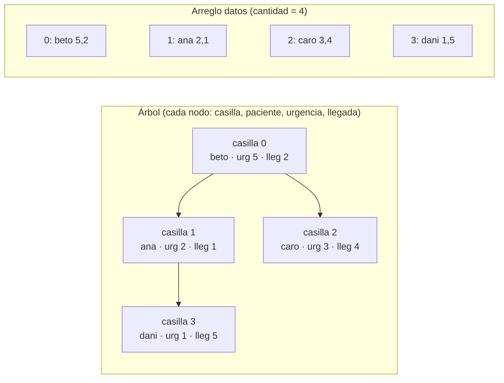
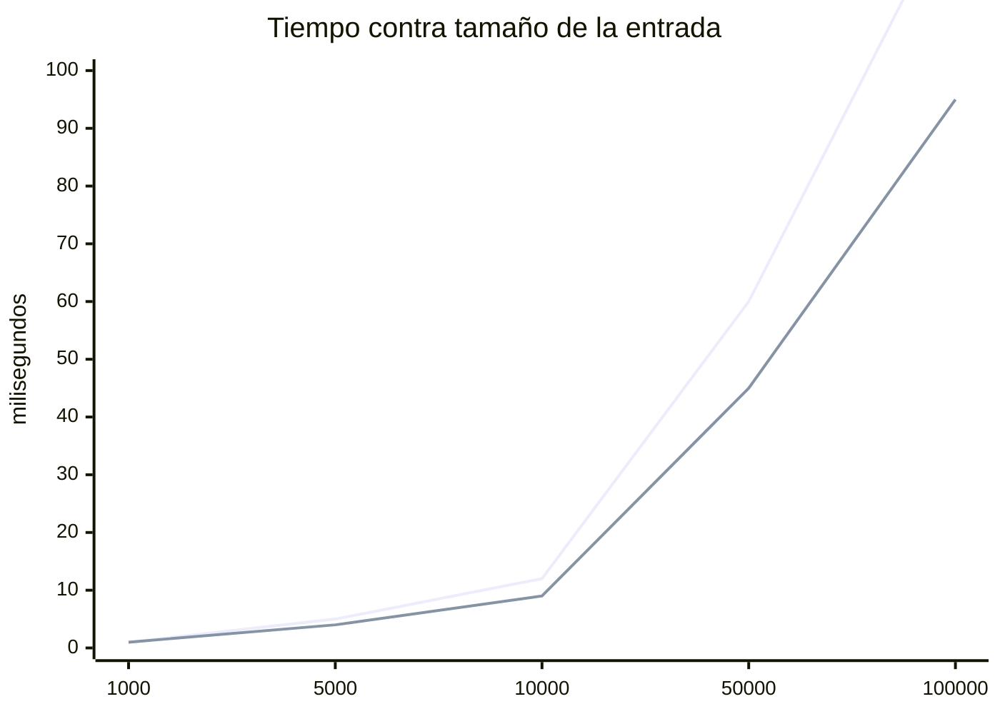

# Informe final

*(Parte del informe del avance, corregido con la realimentación.)*

## 1. El escenario y el modelado

(Del avance, corregido.)

## 2. Las dos estructuras

(Qué operaciones expone cada una y por qué la interfaz es la misma.)

## 3. Análisis formal de complejidad

### Cola circular: el invariante

Para abreviar, sea $\text{pos}(i) = (\text{frente} + i) \bmod \text{capacidad}$ la casilla del arreglo donde está el paciente que ocupa el lugar $i$ de la fila, contando desde 0. El invariante de la cola es:

$$
I_{\text{cola}}: \quad
0 \leq \text{cantidad} \leq \text{capacidad}
\;\land\;
0 \leq \text{frente} < \text{capacidad}
\;\land\;
\forall i \,\big(0 \leq i < \text{cantidad} - 1 \;\rightarrow\; \text{datos}[\text{pos}(i)].\text{llegada} < \text{datos}[\text{pos}(i+1)].\text{llegada}\big)
$$

Es decir: la cantidad y el frente están dentro de sus rangos, y los pacientes que esperan ocupan las casillas $\text{pos}(0), \ldots, \text{pos}(\text{cantidad} - 1)$ en orden de llegada: cada uno llegó antes que el que tiene detrás.

**Quién lo establece y quién lo preserva:**

- `crearSala` lo **establece**: deja $\text{cantidad} = 0$ y $\text{frente} = 0$, y con la sala vacía no hay ningún $i$ en el rango, así que la tercera parte se cumple sin nada que revisar.
- `registrar` lo **preserva**: pone al paciente nuevo en $\text{pos}(\text{cantidad})$, justo detrás del último, y como su `llegada` es el número de la orden actual, es mayor que la de todos los que ya esperan. Solo suma si la sala no está llena, así que `cantidad` no pasa de la capacidad.
- `atender` lo **preserva**: saca al de $\text{pos}(0)$ y avanza `frente` con el módulo, así que el que era el lugar 1 pasa a ser el lugar 0 y los demás siguen en el mismo orden. Solo resta si hay alguien, así que `cantidad` no queda negativa.
- `cantidad`, `estaVacia` y `estaLlena` no cambian nada, así que lo preservan.

### Cola circular: `registrar`

**Teorema.** Sea $n$ el número de pacientes que esperan en la sala. El tiempo de `registrar` en la cola circular cumple $T(n) \in O(1)$, y su espacio extra cumple $S(n) \in O(1)$.

**Demostración.** Se procede de forma directa: se cuentan las operaciones elementales en el peor caso, que es cuando la sala no está llena y el paciente sí entra, porque es cuando se ejecutan todas las líneas.

*Desarrollo.* `registrar` no tiene ciclos ni llamadas recursivas: cada línea se ejecuta a lo sumo una vez. Se cuentan las asignaciones, comparaciones, operaciones aritméticas y retornos:

| Línea | Operaciones |
|---|---|
| `int ok = 0` | 1 |
| `estaLlena(c)`: comparar `cantidad` con `capacidad` y retornar | 2 |
| `if (!estaLlena(c))` | 1 |
| `pos = (frente + cantidad) % capacidad` | 3 |
| `datos[pos] = p` | 1 |
| `cantidad += 1` | 1 |
| `ok = 1` | 1 |
| `return ok` | 1 |

Ninguna de estas cantidades depende de $n$: el arreglo no se recorre, porque la posición donde entra el paciente se calcula directamente con el módulo. Entonces

$$T(n) = 11 \leq 11 \cdot 1 \quad \text{para todo } n \geq 1.$$

En espacio, `registrar` solo usa dos variables enteras (`ok` y `pos`) y la copia del paciente que recibe como parámetro; el arreglo `datos` ya fue reservado por `crearSala`. Entonces $S(n) = 2 + 1 = 3 \leq 3 \cdot 1$ para todo $n \geq 1$.

*Conclusión.* Por lo tanto, $T(n) \in O(1)$ con testigos $c = 11$ y $k = 1$, y $S(n) \in O(1)$ con testigos $c = 3$ y $k = 1$.

### Cola circular: `atender`

**Teorema.** Sea $n$ el número de pacientes que esperan en la sala. El tiempo de `atender` en la cola circular cumple $T(n) \in O(1)$, y su espacio extra cumple $S(n) \in O(1)$.

**Demostración.** Se procede de forma directa: se cuentan las operaciones elementales en el peor caso, que es cuando la sala no está vacía y sí se atiende a alguien, porque es cuando se ejecutan todas las líneas.

*Desarrollo.* `atender` no tiene ciclos ni llamadas recursivas: cada línea se ejecuta a lo sumo una vez.

| Línea | Operaciones |
|---|---|
| `int ok = 0` | 1 |
| `estaVacia(c)`: comparar `cantidad` con 0 y retornar | 2 |
| `if (!estaVacia(c))` | 1 |
| `*p = datos[frente]` | 1 |
| `frente = (frente + 1) % capacidad` | 3 |
| `cantidad -= 1` | 1 |
| `ok = 1` | 1 |
| `return ok` | 1 |

Ninguna de estas cantidades depende de $n$. En un arreglo normal, sacar al primero obliga a correr a los $n - 1$ restantes una casilla; aquí el primero no tiene que estar en la casilla 0, sino en la que indica `frente`, así que basta con avanzar `frente` una casilla con el módulo, y ningún paciente se mueve dentro del arreglo. Entonces

$$T(n) = 11 \leq 11 \cdot 1 \quad \text{para todo } n \geq 1.$$

En espacio, `atender` solo usa la variable entera `ok` y el puntero `p` que recibe como parámetro; el paciente que sale se copia en una variable de quien llama. Entonces $S(n) = 2 \leq 2 \cdot 1$ para todo $n \geq 1$.

*Conclusión.* Por lo tanto, $T(n) \in O(1)$ con testigos $c = 11$ y $k = 1$, y $S(n) \in O(1)$ con testigos $c = 2$ y $k = 1$.

### Cola circular: `crearSala`

**Teorema.** Sea $N$ la capacidad de la sala. El tiempo de `crearSala` cumple $T(N) \in O(1)$, y su espacio cumple $S(N) \in O(N)$.

**Demostración.** Se procede de forma directa: se cuentan las operaciones en el peor caso, que es cuando la capacidad llega menor que 1 y los dos `malloc` salen bien, porque es cuando se ejecutan todas las líneas. Para el espacio se cuentan las casillas que se reservan. El costo de `malloc` se toma como constante.

*Desarrollo.* `crearSala` no tiene ciclos: cada línea se ejecuta a lo sumo una vez.

| Línea | Operaciones |
|---|---|
| `if (capacidad < 1)` y `capacidad = 1` | 2 |
| `c = malloc(sizeof(Sala))` | 2 |
| `if (c != NULL)` | 1 |
| `c->datos = malloc(sizeof(Paciente) * capacidad)` | 3 |
| `if (c->datos == NULL)` | 1 |
| `capacidad`, `frente` y `cantidad` del `else` | 3 |
| `return c` | 1 |

Ninguna depende de $N$: el arreglo se reserva de una vez y no se recorre para llenarlo. Entonces

$$T(N) = 13 \leq 13 \cdot 1 \quad \text{para todo } N \geq 1.$$

En espacio, se reserva una estructura `Sala` de tamaño fijo (cuatro campos) y un arreglo de $N$ casillas, una por cada paciente que puede llegar. Contando en casillas, $S(N) = N + 1$. Como $1 \leq N$ para todo $N \geq 1$ (la función garantiza que la capacidad es al menos 1),

$$S(N) = N + 1 \leq N + N = 2N \quad \text{para todo } N \geq 1.$$

*Conclusión.* Por lo tanto, $T(N) \in O(1)$ con testigos $c = 13$ y $k = 1$, y $S(N) \in O(N)$ con testigos $c = 2$ y $k = 1$.

### Cola circular: `destruirSala`

**Teorema.** Sea $N$ la capacidad de la sala. El tiempo de `destruirSala` cumple $T(N) \in O(1)$, y su espacio extra cumple $S(N) \in O(1)$.

**Demostración.** Se procede de forma directa: se cuentan las operaciones en el peor caso, que es cuando la sala existe y se liberan sus dos bloques. El costo de `free` se toma como constante.

*Desarrollo.* La función compara `c` con `NULL` (1 operación) y hace dos llamadas a `free` (2 operaciones): una libera el arreglo `datos` completo como un solo bloque, sin recorrer sus $N$ casillas, y la otra libera la estructura `Sala`. No tiene ciclos y no reserva memoria. Entonces $T(N) = 3 \leq 3 \cdot 1$ y $S(N) = 0 \leq 1 \cdot 1$ para todo $N \geq 1$.

*Conclusión.* Por lo tanto, $T(N) \in O(1)$ con testigos $c = 3$ y $k = 1$, y $S(N) \in O(1)$ con testigos $c = 1$ y $k = 1$.

### Cola circular: `cantidad`, `estaVacia` y `estaLlena`

**Teorema.** Sea $n$ el número de pacientes que esperan. El tiempo de cada una de las tres consultas `cantidad`, `estaVacia` y `estaLlena` cumple $T(n) \in O(1)$, y su espacio extra cumple $S(n) \in O(1)$.

**Demostración.** Se procede de forma directa: cada consulta es una sola línea, y se cuentan sus operaciones.

*Desarrollo.*

| Operación | Lo que hace | Operaciones |
|---|---|---|
| `cantidad` | retorna el campo `cantidad` | 1 |
| `estaVacia` | compara `cantidad` con 0 y retorna | 2 |
| `estaLlena` | compara `cantidad` con `capacidad` y retorna | 2 |

Ninguna recorre el arreglo, porque el número de pacientes ya está guardado en el campo `cantidad`, que `registrar` y `atender` mantienen al día. Ninguna reserva memoria. Entonces, para las tres, $T(n) \leq 2 \leq 2 \cdot 1$ y $S(n) = 0 \leq 1 \cdot 1$ para todo $n \geq 1$.

*Conclusión.* Por lo tanto, las tres cumplen $T(n) \in O(1)$ con testigos $c = 2$ y $k = 1$, y $S(n) \in O(1)$ con testigos $c = 1$ y $k = 1$.

### Montículo: el invariante

Un montículo binario de máximos guardado en `datos`, con índices desde 0. Sea $\text{padre}(i) = \lfloor (i-1)/2 \rfloor$ para $i \geq 1$; los hijos de $i$ son $2i+1$ y $2i+2$. Sea $a \preceq b$ ("$a$ va antes o igual que $b$") la relación

$$
a \preceq b \;\iff\; a.\text{urgencia} > b.\text{urgencia} \;\lor\; \big(a.\text{urgencia} = b.\text{urgencia} \;\land\; a.\text{llegada} \leq b.\text{llegada}\big).
$$

Como cada `LLEGA` tiene su propio número de orden, dos pacientes distintos nunca tienen la misma `llegada`, así que $\preceq$ es un orden total y transitivo sobre los pacientes de la sala: de dos pacientes distintos, siempre uno va antes que el otro. El invariante del montículo es:

$$
I_{\text{mont}}: \quad
0 \leq \text{cantidad} \leq \text{capacidad}
\;\land\;
\text{frente} = 0
\;\land\;
\forall i \,\big(1 \leq i < \text{cantidad} \;\rightarrow\; \text{datos}[\text{padre}(i)] \preceq \text{datos}[i]\big)
$$

Es decir: la cantidad está en su rango, `frente` vale siempre 0, y todo paciente de la casilla $i$ (con $1 \leq i < \text{cantidad}$) va después o igual que su padre. Por transitividad, el que va primero de todos está en la casilla 0, que es donde `atender` lo busca.

**Quién lo establece y quién lo preserva:**

- `crearSala` lo **establece**: deja $\text{cantidad} = 0$ y $\text{frente} = 0$, y con la sala vacía no hay ningún $i$ en el rango $1 \leq i < 0$, así que la tercera parte se cumple sin nada que revisar.
- `registrar` lo **preserva**: solo suma a `cantidad` si no está llena (no pasa de la capacidad), pone al paciente en la casilla `cantidad` y `subir` restablece la tercera parte (ver el invariante de `subir` más abajo). No toca `frente`.
- `atender` lo **preserva**: solo resta si hay alguien (`cantidad` no queda negativa), pasa el último paciente a la raíz y `bajar` restablece la tercera parte (ver el invariante de `bajar`). No toca `frente`.
- `cantidad`, `estaVacia` y `estaLlena` no cambian nada, así que lo preservan.

**Invariante de `subir`.** Sea $i$ la casilla del paciente que sube. Antes de cada comprobación del ciclo se cumple

$$
J_{\text{subir}}: \quad
\forall j \,\big(1 \leq j < \text{cantidad} \,\land\, j \neq i \;\rightarrow\; \text{datos}[\text{padre}(j)] \preceq \text{datos}[j]\big)
\;\land\;
\forall j \,\big(1 \leq j < \text{cantidad} \,\land\, \text{padre}(j) = i \,\land\, i > 0 \;\rightarrow\; \text{datos}[\text{padre}(i)] \preceq \text{datos}[j]\big).
$$

Es decir: el montículo está bien en todas partes salvo, quizás, entre $i$ y su padre; y el padre de $i$ ya va antes que los hijos de $i$. Al empezar, $i = \text{cantidad} - 1$ es una hoja nueva: la primera parte sale de que el resto del arreglo ya era un montículo, y la segunda es vacía porque la hoja no tiene hijos. Si el paciente de $i$ va antes que el de su padre, se intercambian; el padre, que bajó a la casilla $i$, va antes que los hijos de $i$ (segunda parte); el paciente que subió va antes que él (por eso se intercambiaron) y, por transitividad, antes que el hermano de $i$. Así $J_{\text{subir}}$ se cumple para $i := \text{padre}(i)$. El ciclo termina cuando $i = 0$ o cuando $\text{datos}[\text{padre}(i)] \preceq \text{datos}[i]$; en ambos casos $J_{\text{subir}}$ da $I_{\text{mont}}$ completo.

**Invariante de `bajar`.** Sea $i$ la casilla del paciente que baja. Antes de cada comprobación del ciclo se cumple

$$
J_{\text{bajar}}: \quad
\forall j \,\big(1 \leq j < \text{cantidad} \,\land\, \text{padre}(j) \neq i \;\rightarrow\; \text{datos}[\text{padre}(j)] \preceq \text{datos}[j]\big)
\;\land\;
\forall j \,\big(1 \leq j < \text{cantidad} \,\land\, \text{padre}(j) = i \,\land\, i > 0 \;\rightarrow\; \text{datos}[\text{padre}(i)] \preceq \text{datos}[j]\big).
$$

Es decir: el montículo está bien en todas partes salvo, quizás, entre $i$ y sus hijos; y el padre de $i$ ya va antes que los hijos de $i$. Al empezar, $i = 0$ (el último paciente acaba de pasar a la raíz): la primera parte sale de que los demás pares padre-hijo no se tocaron, y la segunda es vacía porque la raíz no tiene padre. Si algún hijo de $i$ existe y va antes que el paciente de $i$, se intercambia con el que va antes de los dos; ese hijo, ahora en $i$, va antes que su hermano (por haberlo elegido) y que el paciente bajado, que quedó en la casilla del hijo; además va después que el padre de $i$ (segunda parte). Así $J_{\text{bajar}}$ se cumple para $i :=$ la casilla del hijo. El ciclo termina cuando ningún hijo existente va antes que el paciente de $i$; entonces $\text{datos}[i] \preceq$ sus hijos, y $J_{\text{bajar}}$ da $I_{\text{mont}}$ completo.

### Montículo: funciones auxiliares

`vaAntes`, `intercambiar`, `subir` y `bajar` son funciones internas del archivo (`static`) que usan `registrar` y `atender`. No tienen recursión: se llaman una a la vez y cada una termina antes de volver a quien la llamó.

| Auxiliar | Líneas y operaciones (peor caso) | Total |
|---|---|---|
| `vaAntes(a, b)` | `antes = 0` (1); comparar urgencias con `>` y con `==`, y llegadas con `<` (3); `antes = 1` (1); `return` (1) | 6 |
| `intercambiar(c, i, j)` | tres asignaciones de un `Paciente`, que es de tamaño fijo (3) | 3 |

Ninguna depende de $n$: solo comparan y copian un número fijo de campos. Entonces $T_{\text{vaAntes}} = 6 \leq 6 \cdot 1$ y $T_{\text{intercambiar}} = 3 \leq 3 \cdot 1$, ambas $O(1)$. De `subir` y `bajar` interesa cuántas veces repiten el ciclo; se acotan dentro de `registrar` y `atender`.

### Montículo: `registrar`

**Teorema.** Sea $n$ el número de pacientes en la sala cuando `registrar` termina (incluye al nuevo, $n \geq 1$). El tiempo de `registrar` en el montículo cumple $T(n) \in O(\log n)$, y su espacio extra cumple $S(n) \in O(1)$.

**Demostración.** Se procede de forma directa: se cuentan las operaciones en el peor caso, que es cuando la sala no está llena y el paciente nuevo sube hasta la raíz, porque es cuando `subir` hace más vueltas. Se apoya en el teorema de la Clase 24: un árbol binario completo con $n$ nodos tiene altura $\lfloor \log_2 n \rfloor$. El montículo guardado en el arreglo es un árbol binario completo, y el paciente nuevo entra en la casilla $n - 1$, una hoja a profundidad a lo sumo $h = \lfloor \log_2 n \rfloor$. Cada vuelta de `subir` que intercambia lo sube un nivel, así que hay a lo sumo $h$ vueltas con intercambio.

*Desarrollo.* Una vuelta de `subir` que intercambia cuesta:

| Línea de la vuelta | Operaciones |
|---|---|
| comprobar `sigue && i > 0` | 2 |
| `padre = (i - 1) / 2` | 3 |
| `vaAntes(...)` | 6 |
| `intercambiar(...)` | 3 |
| `i = padre` | 1 |

Cada vuelta con intercambio cuesta 15. Además, `sigue = true` cuesta 1 y el ciclo termina o con $i = 0$ (una comprobación más, de 2) o con una vuelta sin intercambio (comprobar 2, `padre` 3, `vaAntes` 6, `sigue = false` 1, y la comprobación final de 2, en total 14). Entonces, con $h = \lfloor \log_2 n \rfloor$,

$$T_{\text{subir}}(n) \leq 1 + 15\,h + 14 = 15\,h + 15.$$

Ahora las líneas de `registrar`:

| Línea | Operaciones |
|---|---|
| `int ok = 0` | 1 |
| `estaLlena(c)` (2) y `if (!estaLlena(c))` (1) | 3 |
| `i = cantidad` | 1 |
| `datos[i] = p` | 1 |
| `cantidad += 1` | 1 |
| `subir(c, i)` | $\leq 15\,h + 15$ |
| `ok = 1` | 1 |
| `return ok` | 1 |

Sumando, $T(n) \leq 9 + 15\,h + 15 = 15 \lfloor \log_2 n \rfloor + 24$. Para $n \geq 2$ se tiene $\log_2 n \geq 1$, así que $24 \leq 24 \log_2 n$ y

$$T(n) \leq 15 \log_2 n + 24 \log_2 n = 39 \log_2 n \quad \text{para todo } n \geq 2.$$

En espacio, no hay recursión, así que no se acumulan marcos. En el momento de mayor uso están abiertas `registrar` (`c`, `p`, `ok`, `i`: 4), `subir` (`c`, `i`, `sigue`, `padre`: 4) e `intercambiar` (`c`, `i`, `j`, `temporal`: 4). Entonces $S(n) = 12 \leq 12 \cdot 1$ para todo $n \geq 1$; el arreglo `datos` ya fue reservado por `crearSala`.

*Conclusión.* Por lo tanto, $T(n) \in O(\log n)$ con testigos $c = 39$ y $k = 2$, y $S(n) \in O(1)$ con testigos $c = 12$ y $k = 1$.

### Montículo: `atender`

**Teorema.** Sea $n$ el número de pacientes que esperan en la sala antes de `atender` ($n \geq 1$). El tiempo de `atender` en el montículo cumple $T(n) \in O(\log n)$, y su espacio extra cumple $S(n) \in O(1)$.

**Demostración.** Se procede de forma directa: se cuentan las operaciones en el peor caso, que es cuando la sala no está vacía y el paciente que pasó a la raíz baja hasta una hoja. Después de sacar a uno quedan $n - 1$ nodos, un árbol binario completo cuya altura es $\lfloor \log_2 (n-1) \rfloor \leq \lfloor \log_2 n \rfloor = h$ (Clase 24; si $n = 1$ no queda nadie y `bajar` no intercambia). Cada vuelta de `bajar` que intercambia lo baja un nivel, así que hay a lo sumo $h$ vueltas con intercambio.

*Desarrollo.* Una vuelta de `bajar` que intercambia cuesta:

| Línea de la vuelta | Operaciones |
|---|---|
| comprobar `sigue` | 1 |
| `izquierdo = 2 * i + 1` y `derecho = 2 * i + 2` | 3 + 3 |
| `mejor = i` | 1 |
| primer `if`: comparar con `cantidad` (1) y `vaAntes` (6); `mejor = izquierdo` (1) | 8 |
| segundo `if`: igual que el primero, con `derecho` | 8 |
| `mejor != i` | 1 |
| `intercambiar(...)` | 3 |
| `i = mejor` | 1 |

Cada vuelta con intercambio cuesta 29. Además, `sigue = true` cuesta 1, el ciclo siempre termina con una vuelta sin intercambio (como cota superior, 26: la vuelta sin el intercambio ni `i = mejor`, más `sigue = false`) y una última comprobación de `sigue` (1). Entonces

$$T_{\text{bajar}}(n) \leq 1 + 29\,h + 26 + 1 = 29\,h + 28.$$

Ahora las líneas de `atender`:

| Línea | Operaciones |
|---|---|
| `int ok = 0` | 1 |
| `estaVacia(c)` (2) y `if (!estaVacia(c))` (1) | 3 |
| `*p = datos[0]` | 1 |
| `datos[0] = datos[cantidad - 1]` (una resta y una asignación) | 2 |
| `cantidad -= 1` | 1 |
| `bajar(c, 0)` | $\leq 29\,h + 28$ |
| `ok = 1` | 1 |
| `return ok` | 1 |

Sumando, $T(n) \leq 10 + 29\,h + 28 = 29 \lfloor \log_2 n \rfloor + 38$. Para $n \geq 2$ se tiene $\log_2 n \geq 1$, así que

$$T(n) \leq 29 \log_2 n + 38 \log_2 n = 67 \log_2 n \quad \text{para todo } n \geq 2.$$

En espacio, tampoco hay recursión. En el momento de mayor uso están abiertas `atender` (`c`, `p`, `ok`: 3), `bajar` (`c`, `i`, `sigue`, `izquierdo`, `derecho`, `mejor`: 6) e `intercambiar` (4). Entonces $S(n) = 13 \leq 13 \cdot 1$ para todo $n \geq 1$.

*Conclusión.* Por lo tanto, $T(n) \in O(\log n)$ con testigos $c = 67$ y $k = 2$, y $S(n) \in O(1)$ con testigos $c = 13$ y $k = 1$.

### Montículo: `crearSala`

**Teorema.** Sea $N$ la capacidad de la sala. El tiempo de `crearSala` en el montículo cumple $T(N) \in O(1)$, y su espacio cumple $S(N) \in O(N)$.

**Demostración.** Se procede de forma directa. El código de `crearSala` del montículo es línea por línea el de la cola (el montículo también deja `frente = 0`, que aquí es el valor definitivo). El costo de `malloc` se toma como constante.

*Desarrollo.* No tiene ciclos y cada línea se ejecuta a lo sumo una vez: `capacidad < 1` y su asignación (2), `malloc` de la sala (2), `c != NULL` (1), `malloc` del arreglo (3), `datos == NULL` (1), los tres campos del `else` (3) y `return` (1). Ninguna depende de $N$: el arreglo se reserva de una vez y no se recorre. Entonces $T(N) = 13 \leq 13 \cdot 1$ para todo $N \geq 1$. En espacio se reserva una `Sala` de tamaño fijo y un arreglo de $N$ casillas, así que $S(N) = N + 1 \leq 2N$ para todo $N \geq 1$.

*Conclusión.* Por lo tanto, $T(N) \in O(1)$ con testigos $c = 13$ y $k = 1$, y $S(N) \in O(N)$ con testigos $c = 2$ y $k = 1$.

### Montículo: `destruirSala`

**Teorema.** Sea $N$ la capacidad de la sala. El tiempo de `destruirSala` en el montículo cumple $T(N) \in O(1)$, y su espacio extra cumple $S(N) \in O(1)$.

**Demostración.** Se procede de forma directa. El código es el mismo de la cola: comparar `c` con `NULL` (1) y dos llamadas a `free` (2), una para el arreglo completo como un solo bloque, sin recorrer sus $N$ casillas, y otra para la `Sala`. No tiene ciclos y no reserva memoria.

*Desarrollo.* $T(N) = 3 \leq 3 \cdot 1$ y $S(N) = 0 \leq 1 \cdot 1$ para todo $N \geq 1$.

*Conclusión.* Por lo tanto, $T(N) \in O(1)$ con testigos $c = 3$ y $k = 1$, y $S(N) \in O(1)$ con testigos $c = 1$ y $k = 1$.

### Montículo: `cantidad`, `estaVacia` y `estaLlena`

**Teorema.** Sea $n$ el número de pacientes que esperan. El tiempo de cada una de las tres consultas cumple $T(n) \in O(1)$, y su espacio extra cumple $S(n) \in O(1)$.

**Demostración.** Se procede de forma directa. Las tres consultas son iguales a las de la cola, una sola línea cada una.

*Desarrollo.*

| Operación | Lo que hace | Operaciones |
|---|---|---|
| `cantidad` | retorna el campo `cantidad` | 1 |
| `estaVacia` | compara `cantidad` con 0 y retorna | 2 |
| `estaLlena` | compara `cantidad` con `capacidad` y retorna | 2 |

Ninguna recorre el arreglo: el número de pacientes está guardado en `cantidad`, que `registrar` y `atender` mantienen al día. Ninguna reserva memoria. Entonces $T(n) \leq 2 \leq 2 \cdot 1$ y $S(n) = 0 \leq 1 \cdot 1$ para todo $n \geq 1$.

*Conclusión.* Por lo tanto, las tres cumplen $T(n) \in O(1)$ con testigos $c = 2$ y $k = 1$, y $S(n) \in O(1)$ con testigos $c = 1$ y $k = 1$.

**Referencias.** Cormen, Leiserson, Rivest y Stein, *Introduction to Algorithms*, 4.ª ed.: §6.1 (montículos) y §6.5 (colas de prioridad). Clase 24 (altura de un árbol binario completo) y Clase 26 (montículo en arreglo, subir y bajar).

Resumen de costos:

| Operación | Desde cero | De la biblioteca | Por qué |
|---|---|---|---|
|  |  |  |  |

## 4. Experimentos

Máquina, compilador y banderas con que se midió; cómo se generaron las
entradas; cuántas repeticiones por tamaño.

| $n$ | desde cero (ms) | biblioteca (ms) |
|---|---|---|
| 1000 |  |  |
| 5000 |  |  |
| 10000 |  |  |
| 50000 |  |  |
| 100000 |  |  |

## 5. Lo medido contra lo predicho

(¿Coincide la curva con la cota? Donde no coincida, expliquen por qué:
la constante oculta, la memoria caché, el crecimiento del vector.)

## 6. Conclusiones

(Cuál estructura conviene para este escenario y bajo qué condiciones
cambiaría la respuesta.)
