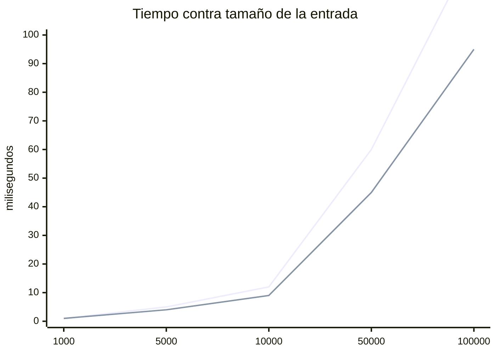

# Informe final

*(Parte del informe del avance, corregido con la realimentación.)*

## 1. El escenario y el modelado

(Del avance, corregido.)

## 2. Las dos estructuras

(Qué operaciones expone cada una y por qué la interfaz es la misma.)

## 3. Análisis formal de complejidad

### Cola circular: el invariante

Para abreviar, sea $\text{pos}(i) = (\text{frente} + i) \bmod \text{capacidad}$ la casilla del arreglo donde está el paciente que ocupa el lugar $i$ de la fila, contando desde 0. El invariante de la cola es:

$$
I_{\text{cola}}: \quad
0 \leq \text{cantidad} \leq \text{capacidad}
\;\land\;
0 \leq \text{frente} < \text{capacidad}
\;\land\;
\forall i \,\big(0 \leq i < \text{cantidad} - 1 \;\rightarrow\; \text{datos}[\text{pos}(i)].\text{llegada} < \text{datos}[\text{pos}(i+1)].\text{llegada}\big)
$$

Es decir: la cantidad y el frente están dentro de sus rangos, y los pacientes que esperan ocupan las casillas $\text{pos}(0), \ldots, \text{pos}(\text{cantidad} - 1)$ en orden de llegada: cada uno llegó antes que el que tiene detrás.

**Quién lo establece y quién lo preserva:**

- `crearSala` lo **establece**: deja $\text{cantidad} = 0$ y $\text{frente} = 0$, y con la sala vacía no hay ningún $i$ en el rango, así que la tercera parte se cumple sin nada que revisar.
- `registrar` lo **preserva**: pone al paciente nuevo en $\text{pos}(\text{cantidad})$, justo detrás del último, y como su `llegada` es el número de la orden actual, es mayor que la de todos los que ya esperan. Solo suma si la sala no está llena, así que `cantidad` no pasa de la capacidad.
- `atender` lo **preserva**: saca al de $\text{pos}(0)$ y avanza `frente` con el módulo, así que el que era el lugar 1 pasa a ser el lugar 0 y los demás siguen en el mismo orden. Solo resta si hay alguien, así que `cantidad` no queda negativa.
- `cantidad`, `estaVacia` y `estaLlena` no cambian nada, así que lo preservan.

### Cola circular: `registrar`

**Teorema.** Sea $n$ el número de pacientes que esperan en la sala. El tiempo de `registrar` en la cola circular cumple $T(n) \in O(1)$, y su espacio extra cumple $S(n) \in O(1)$.

**Demostración.** Se procede de forma directa: se cuentan las operaciones elementales en el peor caso, que es cuando la sala no está llena y el paciente sí entra, porque es cuando se ejecutan todas las líneas.

*Desarrollo.* `registrar` no tiene ciclos ni llamadas recursivas: cada línea se ejecuta a lo sumo una vez. Se cuentan las asignaciones, comparaciones, operaciones aritméticas y retornos:

| Línea | Operaciones |
|---|---|
| `int ok = 0` | 1 |
| `estaLlena(c)`: comparar `cantidad` con `capacidad` y retornar | 2 |
| `if (!estaLlena(c))` | 1 |
| `pos = (frente + cantidad) % capacidad` | 3 |
| `datos[pos] = p` | 1 |
| `cantidad += 1` | 1 |
| `ok = 1` | 1 |
| `return ok` | 1 |

Ninguna de estas cantidades depende de $n$: el arreglo no se recorre, porque la posición donde entra el paciente se calcula directamente con el módulo. Entonces

$$T(n) = 11 \leq 11 \cdot 1 \quad \text{para todo } n \geq 1.$$

En espacio, `registrar` solo usa dos variables enteras (`ok` y `pos`) y la copia del paciente que recibe como parámetro; el arreglo `datos` ya fue reservado por `crearSala`. Entonces $S(n) = 2 + 1 = 3 \leq 3 \cdot 1$ para todo $n \geq 1$.

*Conclusión.* Por lo tanto, $T(n) \in O(1)$ con testigos $c = 11$ y $k = 1$, y $S(n) \in O(1)$ con testigos $c = 3$ y $k = 1$.

### Cola circular: `atender`

**Teorema.** Sea $n$ el número de pacientes que esperan en la sala. El tiempo de `atender` en la cola circular cumple $T(n) \in O(1)$, y su espacio extra cumple $S(n) \in O(1)$.

**Demostración.** Se procede de forma directa: se cuentan las operaciones elementales en el peor caso, que es cuando la sala no está vacía y sí se atiende a alguien, porque es cuando se ejecutan todas las líneas.

*Desarrollo.* `atender` no tiene ciclos ni llamadas recursivas: cada línea se ejecuta a lo sumo una vez.

| Línea | Operaciones |
|---|---|
| `int ok = 0` | 1 |
| `estaVacia(c)`: comparar `cantidad` con 0 y retornar | 2 |
| `if (!estaVacia(c))` | 1 |
| `*p = datos[frente]` | 1 |
| `frente = (frente + 1) % capacidad` | 3 |
| `cantidad -= 1` | 1 |
| `ok = 1` | 1 |
| `return ok` | 1 |

Ninguna de estas cantidades depende de $n$. En un arreglo normal, sacar al primero obliga a correr a los $n - 1$ restantes una casilla; aquí el primero no tiene que estar en la casilla 0, sino en la que indica `frente`, así que basta con avanzar `frente` una casilla con el módulo, y ningún paciente se mueve dentro del arreglo. Entonces

$$T(n) = 11 \leq 11 \cdot 1 \quad \text{para todo } n \geq 1.$$

En espacio, `atender` solo usa la variable entera `ok` y el puntero `p` que recibe como parámetro; el paciente que sale se copia en una variable de quien llama. Entonces $S(n) = 2 \leq 2 \cdot 1$ para todo $n \geq 1$.

*Conclusión.* Por lo tanto, $T(n) \in O(1)$ con testigos $c = 11$ y $k = 1$, y $S(n) \in O(1)$ con testigos $c = 2$ y $k = 1$.

### Cola circular: `crearSala`

**Teorema.** Sea $N$ la capacidad de la sala. El tiempo de `crearSala` cumple $T(N) \in O(1)$, y su espacio cumple $S(N) \in O(N)$.

**Demostración.** Se procede de forma directa: se cuentan las operaciones en el peor caso, que es cuando la capacidad llega menor que 1 y los dos `malloc` salen bien, porque es cuando se ejecutan todas las líneas. Para el espacio se cuentan las casillas que se reservan. El costo de `malloc` se toma como constante.

*Desarrollo.* `crearSala` no tiene ciclos: cada línea se ejecuta a lo sumo una vez.

| Línea | Operaciones |
|---|---|
| `if (capacidad < 1)` y `capacidad = 1` | 2 |
| `c = malloc(sizeof(Sala))` | 2 |
| `if (c != NULL)` | 1 |
| `c->datos = malloc(sizeof(Paciente) * capacidad)` | 3 |
| `if (c->datos == NULL)` | 1 |
| `capacidad`, `frente` y `cantidad` del `else` | 3 |
| `return c` | 1 |

Ninguna depende de $N$: el arreglo se reserva de una vez y no se recorre para llenarlo. Entonces

$$T(N) = 13 \leq 13 \cdot 1 \quad \text{para todo } N \geq 1.$$

En espacio, se reserva una estructura `Sala` de tamaño fijo (cuatro campos) y un arreglo de $N$ casillas, una por cada paciente que puede llegar. Contando en casillas, $S(N) = N + 1$. Como $1 \leq N$ para todo $N \geq 1$ (la función garantiza que la capacidad es al menos 1),

$$S(N) = N + 1 \leq N + N = 2N \quad \text{para todo } N \geq 1.$$

*Conclusión.* Por lo tanto, $T(N) \in O(1)$ con testigos $c = 13$ y $k = 1$, y $S(N) \in O(N)$ con testigos $c = 2$ y $k = 1$.

### Cola circular: `destruirSala`

**Teorema.** Sea $N$ la capacidad de la sala. El tiempo de `destruirSala` cumple $T(N) \in O(1)$, y su espacio extra cumple $S(N) \in O(1)$.

**Demostración.** Se procede de forma directa: se cuentan las operaciones en el peor caso, que es cuando la sala existe y se liberan sus dos bloques. El costo de `free` se toma como constante.

*Desarrollo.* La función compara `c` con `NULL` (1 operación) y hace dos llamadas a `free` (2 operaciones): una libera el arreglo `datos` completo como un solo bloque, sin recorrer sus $N$ casillas, y la otra libera la estructura `Sala`. No tiene ciclos y no reserva memoria. Entonces $T(N) = 3 \leq 3 \cdot 1$ y $S(N) = 0 \leq 1 \cdot 1$ para todo $N \geq 1$.

*Conclusión.* Por lo tanto, $T(N) \in O(1)$ con testigos $c = 3$ y $k = 1$, y $S(N) \in O(1)$ con testigos $c = 1$ y $k = 1$.

### Cola circular: `cantidad`, `estaVacia` y `estaLlena`

**Teorema.** Sea $n$ el número de pacientes que esperan. El tiempo de cada una de las tres consultas `cantidad`, `estaVacia` y `estaLlena` cumple $T(n) \in O(1)$, y su espacio extra cumple $S(n) \in O(1)$.

**Demostración.** Se procede de forma directa: cada consulta es una sola línea, y se cuentan sus operaciones.

*Desarrollo.*

| Operación | Lo que hace | Operaciones |
|---|---|---|
| `cantidad` | retorna el campo `cantidad` | 1 |
| `estaVacia` | compara `cantidad` con 0 y retorna | 2 |
| `estaLlena` | compara `cantidad` con `capacidad` y retorna | 2 |

Ninguna recorre el arreglo, porque el número de pacientes ya está guardado en el campo `cantidad`, que `registrar` y `atender` mantienen al día. Ninguna reserva memoria. Entonces, para las tres, $T(n) \leq 2 \leq 2 \cdot 1$ y $S(n) = 0 \leq 1 \cdot 1$ para todo $n \geq 1$.

*Conclusión.* Por lo tanto, las tres cumplen $T(n) \in O(1)$ con testigos $c = 2$ y $k = 1$, y $S(n) \in O(1)$ con testigos $c = 1$ y $k = 1$.

Resumen de costos:

| Operación | Desde cero | De la biblioteca | Por qué |
|---|---|---|---|
|  |  |  |  |

## 4. Experimentos

Máquina, compilador y banderas con que se midió; cómo se generaron las
entradas; cuántas repeticiones por tamaño.

| $n$ | desde cero (ms) | biblioteca (ms) |
|---|---|---|
| 1000 |  |  |
| 5000 |  |  |
| 10000 |  |  |
| 50000 |  |  |
| 100000 |  |  |

## 5. Lo medido contra lo predicho

(¿Coincide la curva con la cota? Donde no coincida, expliquen por qué:
la constante oculta, la memoria caché, el crecimiento del vector.)

## 6. Conclusiones

(Cuál estructura conviene para este escenario y bajo qué condiciones
cambiaría la respuesta.)
